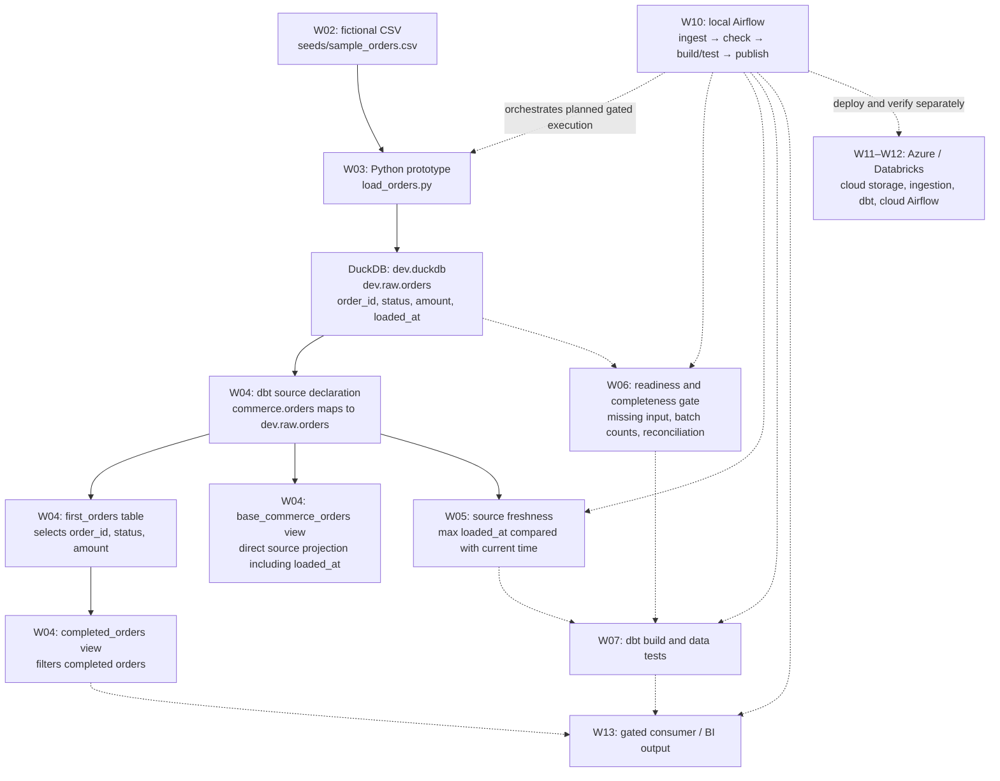
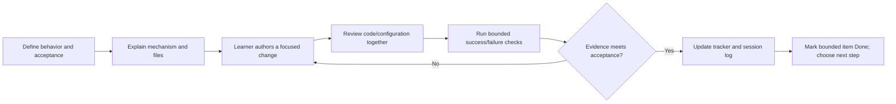

# Dataflow and developer workflow tracker

Updated: 2026-10-16 (America/Los_Angeles).

This is the current work-item status reference. The master training plan defines
the wider curriculum; this file tracks the representative orders pipeline and
its delivery workflow. No fixed session durations apply.

## Status and evidence rules

- **TBD**: planned; implementation or acceptance has not started. Design details may still need decisions.
- **In Progress**: started, but the stated acceptance is incomplete.
- **Done**: the bounded work item has the evidence stated here. It does not imply production readiness or mastery of the whole topic.
- Identify evidence as file-inspected, artifact-verified, learner-reported, or prior checkpoint. Keep local and cloud acceptance separate.
- After every training step, the agent updates the affected row, current position,
  evidence, and exact next action. Record failure and recovery without erasing the
  earlier evidence. A command supplied is not a command confirmed executed.
- Diagram nodes use work-item IDs; the table is authoritative for status.
- Update this file at every checkpoint before responding, even if the status remains unchanged. The checkpoint response must link this tracker and briefly state the current status and next action; do not wait for an owner reminder or handoff.

## Thread continuity review

- Thread label: W05 resume — new thread confirmed 2026-10-16.
- Initialized at **0**; counted checkpoints: **17** (docs branch verified; diff review passed; staging/commit assigned).
- Last scheduled review: checkpoint **15**.
- Next scheduled review: checkpoint **20**, then 25, 30, and so on.
- Assessment: history now spans dbt debugging, delivery-plan revision and Git bootstrap. Finish the bounded baseline checkpoint here; assess a handoff before the substantial runtime/reproducibility phase. This is qualitative, not a capacity estimate.
- Recommendation: continue through baseline commit; next scheduled review at 20, with earlier reassessment at the phase boundary.
- Previous thread review preserved: baseline checkpoint 1 on 2026-10-16 recommended a handoff due to substantial accumulated output and repeated selector explanations before completeness implementation. Owner accepted by opening this new thread; earlier lifetime count remains unknown.

## Where we are now

**Current: W08 repository foundation — In Progress, prioritized before further pipeline changes. W05–W07 pending acceptance remains recorded.**

The loader and source declaration exist. Learner output verified a stale failure
with dbt Core 1.12.0 / DuckDB adapter 1.11.0, followed by learner-reported PASS
after reloading. The latest inspected `target/sources.json` records **warn**, at
2026-10-16 04:32:23 UTC (2026-10-15 21:32:23 Pacific): approximately six minutes
since loading. This is consistent with the configured five-minute warning and
ten-minute error thresholds; it does not invalidate the earlier reported PASS.
Freshness status changes as data ages; task status records learning/delivery progress.

Next: learner stages the six changed instruction/checkpoint files explicitly,
runs git diff --cached --check and reviews git diff --cached, then commits with
message "docs: require separately copyable shell commands". Supply git status
--short --branch. Staging and commit pending; no agent Git mutation.

Checkpoint 17: verified branch docs/command-format. Six modified docs files,
no staged changes before this update. Reviewed root/linked instruction diff;
git diff --check passed. No executable code changed, so no dbt rerun required.
Baseline 8590240 remains verified. After docs commit, teach local reviewed
integration and branch cleanup (not hosted PR/CI); then reassess thread handoff
before runtime/reproducibility. W05 reasoning and W06/W07 failure/blocking/recovery
remain pending.

Checkpoint 11: learner build output and inspected run_results.json agree: 3 models
succeeded, 5 tests passed with zero failures, dbt 2.0.8, generated
2026-10-16T22:54:22.373067537Z. Models are first_orders (table), completed_orders
(view), and base_commerce_orders (view). File inspection confirms base_commerce_orders
reads the source directly and retains loaded_at; first_orders also reads source
directly, completed_orders reads first_orders. Base model authorship/generation is
not established. This verifies selected local build success, not freshness,
negative-case blocking, production batch completeness, or intended Core runtime.

Prior learner evidence: raw preview matches fixture IDs 1–3, statuses and amounts;
aggregate shows 3 rows / 3 distinct IDs; all rows share loaded_at
2026-10-15T21:26:19.750278-07:00. Learner proposed min_count; exact-versus-minimum
count and freshness/completeness reasoning remain to be demonstrated through the
exercise. W05 is not promoted to Done. Source selectors use logical
`source:commerce.orders`, not physical `dev.raw.orders`.

## Intended dataflow

Solid arrows show the existing local data path. Dashed arrows show planned gates
and extensions. Existing execution is manual; the future gating is not enforced.

`SRC` is metadata, not a second copy of the data. `source()` resolves that metadata
to the physical relation; `ref()` connects dbt models. `loaded_at` is explicitly
created by `current_timestamp as loaded_at` in the loader. It is not added by dbt,
and the current downstream model does not select it. The CSV is currently read by
Python; the earlier dbt seed exercise is not an additional ingestion stage.

## Developer workflow applied to every work item

### SQL Server / Snowflake naming example

These are illustrative target mappings, not selected or provisioned deployments.
The Azure/Databricks architecture decision in W11 remains pending.

| Layer | SQL Server example | Snowflake example |
|---|---|---|
| Connection | SQL Server instance and authenticated identity via target adapter | Snowflake account, role and compute warehouse via target adapter |
| Existing raw relation | TrainingDev.raw.orders | TRAINING_DEV.RAW.ORDERS |
| Logical dbt source | commerce.orders | commerce.orders |
| Model resource | first_orders | first_orders |
| Illustrative model output | TrainingDev.analytics.first_orders | TRAINING_DEV.ANALYTICS.FIRST_ORDERS |

The output schema must be configured; source schema raw does not set the model
output schema. `source('commerce', 'orders')` resolves the source YAML mapping to
the physical relation. `--select first_orders` selects the project model;
`--inline "select * from ..."` queries a physical relation. dbt executes SQL through
the selected adapter/connection; it does not transfer data from SQL Server to
Snowflake just because a source is declared. Such movement requires ingestion
before the Snowflake source can be queried. Credentials, permissions, SQL dialect,
adapter compatibility and deployment configuration require platform-specific work.

References: [dbt source()](https://docs.getdbt.com/reference/dbt-jinja-functions/source),
[Snowflake naming](https://docs.snowflake.com/en/en/sql-reference/name-resolution),
[SQL Server three-part names](https://learn.microsoft.com/en-us/sql/t-sql/functions/object-name-transact-sql).

The table names the maintained files or intended deliverables for each item.
`target/` and `logs/` contain generated execution evidence, not hand-authored
configuration. Git/PR/CI promotion is a planned addition in W08–W09, not an active
enforcement mechanism. Preserve learner-led exercises rather than implementing
them silently for the learner.

## Work items and acceptance

| ID / work item | Status | Developer workflow: author → execute/review → accept | Evidence and remaining work |
|---|---|---|---|
| W01 — Canonical WSL workspace and dbt runtime | Done | Preserve notes in WSL → activate Linux `.venv`, inspect selected executable, run connection check → confirm working local runtime | Prior checkpoint: all 18 source files matched before local edits; VS Code WSL confirmed. This thread: learner ran Core 1.12.0 / DuckDB 1.11.0 after PATH correction. Permanent shell startup ordering remains unverified; PowerShell variable and Azure setup are separate pending work. |
| W02 — Fictional seed fixture | Done | Author `seeds/sample_orders.csv` → load/preview fixture → verify representative rows | Prior checkpoint: three-row seed preview and completed orders 1 and 3 reported. Fixture is now reused by Python ingestion. |
| W03 — Minimal local ingestion prototype | Done | Author `load_orders.py` → create/replace `raw.orders`, add load timestamp → inspect loaded row count/timestamp | File inspected; earlier learner reported three rows and timestamp. Recovery reload reported this thread. Scope is demonstration only; professional loader is W08. |
| W04 — Logical source and SQL model chain | Done | Maintain `models/sources.yml` and model SQL → resolve `source()`/`ref()`, inspect compiled SQL and preview → verify dependency chain | Prior checkpoint: compiled `FROM dev.raw.orders`, completed orders 1 and 3 preview. Files inspected again. Does not establish a full source-backed build/test acceptance; see W07. |
| W05 — Freshness and source inspection | In Progress | Add table-level freshness config in `sources.yml` → run stale/reload/check and raw preview → explain thresholds, timestamps, selectors, exit status and `sources.json` | Config inspected: warn >5 min, error >10 min. Core stale failure supplied; recovery PASS learner-reported; latest artifact warn verified. Learner aggregate output confirms 3 rows / 3 distinct IDs and latest_load 2026-10-15T21:26:19.750278-07:00. Learner raw preview matches all fixture rows and shows identical loaded_at values. Freshness-versus-completeness comprehension pending; exit code not supplied. |
| W06 — Input readiness and batch completeness | In Progress | Define expected batch/input contract and reconciliation → implement checks → demonstrate missing/partial loads block downstream work | Fixture-only exact count=3 test now named assert_orders_fixture_count.sql; PASS/zero failures artifact verified at checkpoint 9 (dbt 2.0.8). Temporary expectation=4 failure and restoration=3 recovery assigned, pending. Intended Core runtime selection remains unverified. Batch identity, independent expected counts, missing/partial failure and downstream gating remain pending. Do not generalize fixture count to production. |
| W07 — Source-backed build/test and failure recovery | In Progress | Maintain `models/orders.yml` with SQL → build/test, inject bounded invalid input, inspect failure and restore → verify current full source-backed build and recovery | Prior checkpoint verifies four first_orders tests and deliberate duplicate failure before the current source-backed acceptance. Checkpoint 11: learner output and artifact verify selected source-backed build: 3 models success / 5 tests pass, dbt 2.0.8. Source-count failure blocking and recovery remain pending. |
| W08 — Maintainable Python loader and repository foundation | In Progress | Refactor prototype into reusable logic/configuration; establish Git and reproducible dependencies → validate inputs, errors/logging, safe writes and meaningful tests → demonstrate repeatability and recovery | Checkpoint 16: baseline commit 8590240 verified, main clean before requested instruction edits. Learner docs branch next; runtime reproducibility and remaining repository acceptance pending. Git foundation moved before further pipeline features; runtime reproducibility and loader refactor pending. Define batch/write semantics before expanding loader. |
| W09 — dbt professional delivery and CI/CD | TBD | Author isolated targets and CI configuration → exercise reviewed SQL/YAML change, failing checks, correction and promotion → verify artifact retention and cleanup | Local CI simulation, hosted CI, and deployed execution need distinct evidence. Teach manifest/state/deferral after basic build isolation. |
| W10 — Local Airflow pipeline | TBD | Author DAG/config using reusable ingestion → ingest, readiness/freshness/completeness, dbt build/test, publication gating → prove success and blocked downstream tasks/recovery | Cover data intervals, retries, idempotency, backfills, concurrency, secrets and logs. No scheduler or DAG deployment verified. |
| W11 — Cloud design and billing readiness | TBD | Choose compatible Azure/Databricks target and cloud Airflow hosting; estimate costs → verify billing, identity and budget alerts → approve bounded lab design and teardown | $200/month ceiling, target below $150. Billing upgrade and budget configuration unverified. Alerts are not a hard cap. Verify current official guidance before provisioning. |
| W12 — Actual cloud implementation | TBD | Adapt storage/identity/runtime and deploy approved revision → run cloud-hosted Airflow plus analytical workload → verify success, failure/recovery, cost and teardown | Required outcome. Local simulation or local Airflow calling cloud storage does not count as cloud-hosted orchestration. SQL/Delta first, gradual PySpark exposure. |
| W13 — Consumer / BI publication | TBD | Define consumer contract and semantic/report output → publish only after upstream gates → verify output and failure behavior | Consumer implementation and hosting still undecided. Existing completed_orders view is a teaching output, not a deployed BI product. |
| W14 — Operational and portfolio acceptance | TBD | Maintain runbook, architecture decisions and scenario evidence → rehearse failures/backfill/schema change and recovery → review reproducibility, ownership and local/cloud proof | Include missing input, partial/stale batch, duplicates, late arrival, schema drift and task failure. Deeper Python follows gradual exposure; broader curriculum remains in the master plan. |

## Step history

| Date (Pacific) | Step | Evidence / status effect |
|---|---|---|
| 2026-10-15 | Reconciled current handoff and files | Resumed source freshness rather than repeating setup. |
| 2026-10-15 | Diagnosed dbt executable selection | Learner selected user-installed 2.0.8 despite active venv; reactivation restored Core 1.12.0. |
| 2026-10-15 | Exercised stale check and reload | Learner supplied stale failure and reported recovery PASS; W05 still requires interpretation/preview acceptance. |
| 2026-10-15 | Explained physical vs logical names | `--select dev.raw.orders` selected nothing; source preview command supplied, output pending. |
| 2026-10-15 | Created living dataflow/workflow tracker | Inspected latest freshness artifact: warn. Added mandatory per-step tracking to project instructions. |
| 2026-10-15 | Confirmed visible updates at every checkpoint | Agent must update before each checkpoint response and include a tracker link with status/next action. W05 remains In Progress; source preview and interpretation remain next. |
| 2026-10-15 | Assigned W05 source inspection checkpoint | Supplied dbt show source preview and a single completeness reasoning check. Awaiting learner evidence; no command executed by agent and no status promotion. |
| 2026-10-15 | Clarified source selector naming | Rechecked sources.yml: logical source commerce, table orders; database dev and schema raw are physical mapping properties, not selector segments. Use source:commerce.orders. W05 remains In Progress; preview and comprehension pending. |
| 2026-10-15 | Clarified dbt show selection versus SQL | dbt show --select dev.raw.orders does not interpret the physical address as SQL. Use --inline "select * from dev.raw.orders" or the source() mapping to preview raw rows; --select first_orders previews the dbt model. W05 remains In Progress; learner preview pending. |
| 2026-10-15 | Refined selector mental model | Clarified that dbt's resource selector, not a model or the database connection, fails to match dev.raw.orders. Physical table addresses belong in SQL. W05 remains In Progress; preview and completeness check pending. |
| 2026-10-15 | Mapped naming to SQL Server and Snowflake | Added illustrative connection/source/model/output mapping and ingestion boundary. No platform selected or provisioned; W05 remains In Progress and W11 remains TBD. |
| 2026-10-16 | Resumed with raw preview and aggregate diagnostic | Rechecked fixture: three orders, IDs 1–3. Assigned read-only preview plus row count/distinct ID/latest load query. Output pending; W05 remains In Progress. No completeness gate implemented. |

| 2026-10-16 | Strengthened proactive thread continuity | Root and training AGENTS.md now require qualitative length checks at checkpoints, saved handoff before transition advice, and visible resume summary/prompt. W05 remains In Progress; preview/aggregate outputs pending. |

| 2026-10-16 | Cadence baseline checkpoint 1: continuity review | Added explicit review every five checkpoints; early qualitative handoff recommended before the next phase. Saved handoff; W05 preview/diagnostic results still pending. |

| 2026-10-16 | New thread checkpoint 1: resumed W05 | Read canonical instructions, handoff and numbered logs; re-inspected source YAML, loader and three-row fixture. Initialized counter at 0, incremented to 1 for this assignment; review due at 5. Preview and aggregate commands reissued for learner execution, results and completeness reasoning still pending. No data reload or dbt execution by agent; W05 remains In Progress. |

| 2026-10-16 | New thread checkpoint 2: aggregate evidence | Learner supplied actual_rows=3, distinct_orders=3 and latest_load=2026-10-15T21:26:19.750278-07:00. Matches fixture count without establishing exact IDs or values. Raw preview and completeness reasoning pending; no current freshness command result inferred. W05 In Progress; next review at 5. |

| 2026-10-16 | New thread checkpoint 3: raw preview evidence | Learner preview matches fixture IDs 1–3, statuses and amounts; all rows show loaded_at 2026-10-15T21:26:19.750278-07:00. Raw preview acceptance recorded; completeness reasoning still pending. W05 In Progress; next review at 5. |

| 2026-10-16 | New thread checkpoint 4: count-based completeness proposal | Learner proposed min_count. Explained that newest loaded_at can pass freshness with one recent row; a lower bound detects shortages but can admit extras. For an exact 100-order batch contract, reconcile batch-scoped actual/distinct counts with an independently supplied expectation. Understanding of exact versus minimum counts and expected-count provenance remains pending; no gate implemented. W05 In Progress; review due at 5. |

| 2026-10-16 | New thread checkpoint 5: source tests and continuity review | Explained YAML config versus executed SQL on source data, selected data tests in dbt build, separate Core freshness command, and need to author a count test. No test added or executed. W05 In Progress; count contract reasoning pending. Scheduled qualitative review: bounded history and one active branch, continue; next review 10. |

| 2026-10-16 | New thread checkpoint 6: first completeness test assigned | Owner requested next step. Verified test-paths points to tests; assigned learner-authored singular SQL test assert_orders_fixture_count and targeted dbt test. Exact count=3 is bounded to fixture; no code authored or dbt run by agent. W06 In Progress; W05 reasoning still pending. |

| 2026-10-16 | New thread checkpoint 7: diagnosed Jinja syntax error | Learner supplied dbt1502 error. Inspected tests/asser_orders_fixture_count.sql: stray P before source() in Jinja; aggregate logic otherwise matches exercise. Supplied exact line correction and selector matching actual filename. No file edit or dbt execution by agent; rerun pending. W06 In Progress. |

| 2026-10-16 | New thread checkpoint 8: saved correction verified | Re-inspected test: stray P removed, source() expression valid. Learner repeated same error; cannot establish whether output predates save or came from another runtime. Supplied existing-venv activation, executable/version check and targeted rerun. No agent test execution. W06 In Progress. |

| 2026-10-16 | New thread checkpoint 9: count-test PASS verified | Inspected renamed assert_orders_fixture_count.sql and run_results.json: PASS, zero failures, dbt 2.0.8. Assigned temporary expectation 4 then restoration 3 to prove failure/recovery without source mutation. This is not partial-ingestion/gating acceptance. W06 In Progress; runtime consistency remains open; next continuity review 10. |

| 2026-10-16 | New thread checkpoint 10: build assignment and continuity review | File still expects 3; latest PASS artifact unchanged and no new count-test failure/recovery in inspected log. Assigned source-descendant dbt build; no execution claimed. W07 In Progress, W06 failure/recovery and W05 reasoning pending. Qualitative review: focused history, explicit open items; continue, next review 15. |

| 2026-10-16 | New thread checkpoint 11: selected build success verified | Learner output and run_results.json confirm 3 successful models / 5 passing tests, dbt 2.0.8. Inspected base_commerce_orders: direct source projection retaining loaded_at, separate branch from first_orders. Diagram updated. Assigned temporary count=4 build failure/skip, then restore=3 recovery; pending. W07 In Progress. |

| 2026-10-16 | New thread checkpoint 12: mandatory Git lifecycle | Owner requires production-style lifecycle and meaningful Git checkpoints. Updated instructions/master plan/capstone, prepared root .gitignore, rechecked no repo. Assigned learner git init and status before staging review; no Git mutation by agent. W08 In Progress, existing failure/recovery evidence pending. |

| 2026-10-16 | New thread checkpoint 13: branch-to-release procedure | Owner requires branching and all proper lifecycle steps. Plan now specifies baseline bootstrap, clean-main feature branch, acceptance/diff/validation/staging/commit, hosted PR/CI/review, conflict handling, integration/cleanup and release/recovery. Local simulation versus hosted enforcement and solo-review limits explicit. No Git operations executed; learner init/status remains next. |

| 2026-10-16 | New thread checkpoint 14: repository initialization verified | git status/branch confirm main with untracked files; HEAD absent. Added .vscode/ and .user.yml exclusions. Assigned explicit staging plus staged stat/check/diff review; no agent staging or commit. W08 In Progress; first feature branch follows reviewed baseline. |

| 2026-10-16 | New thread checkpoint 15: staged baseline review | 41 staged files inspected for scope; bounded credential scan no matches. Whitespace check found SQL/YAML whitespace and Markdown hard breaks; working-tree cleanup preserves behavior/formatting. Learner restage/check/commit next. Scheduled qualitative review: finish baseline here, reassess before runtime phase; next scheduled review 20. |

Checkpoint 15 follow-up: Git warned of LF-to-CRLF conversion. Prepared repository .gitattributes (* text=auto eol=lf); stage it before renormalizing baseline. No global Git config change.

| 2026-10-16 | New thread checkpoint 16: baseline commit and command format | Verified clean main and baseline commit 8590240 before docs edits. Owner requires one shell command per separate code block; persisted in root/linked AGENTS.md. Assigned docs/command-format branch and diff review for requested docs changes. No agent branch/commit operation. |

| 2026-10-16 | New thread checkpoint 17: documentation branch verified | Confirmed docs/command-format, six modified docs files, instruction diff matches request; whitespace check passed. Assigned explicit staging, cached review/check and focused docs commit. No agent staging/commit; local integration next after commit verification. |
