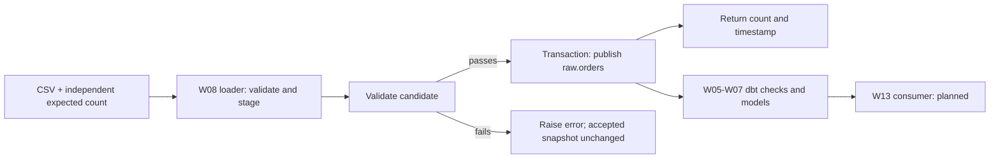
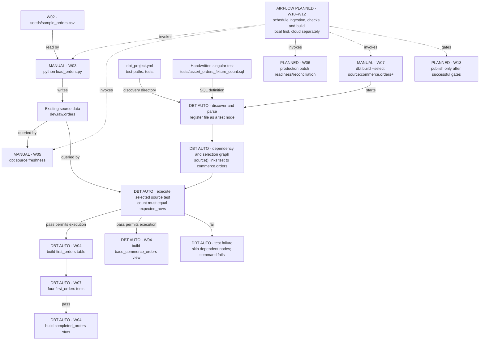
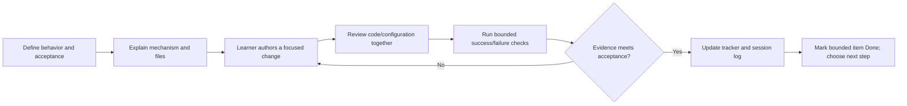

# Dataflow and developer workflow tracker

Updated: 2026-10-18 (America/Los_Angeles).

This is the current work-item status reference. The master training plan defines
the wider curriculum; this file tracks the representative orders pipeline and
its delivery workflow. No fixed session durations apply.

## Status and evidence rules

- **TBD**: planned; implementation or acceptance has not started. Design details may still need decisions.
- **In Progress**: started, but the stated acceptance is incomplete.
- **Done**: the bounded work item has the evidence stated here. It does not imply production readiness or mastery of the whole topic.
- Identify evidence as file-inspected, artifact-verified, learner-reported, or prior checkpoint. Keep local and cloud acceptance separate.
- After every training step, the agent updates the affected row, current position,
  evidence, and exact next action. Record failure and recovery without erasing the
  earlier evidence. A command supplied is not a command confirmed executed.
- Diagram nodes use work-item IDs; the table is authoritative for status.
- Update this file at every checkpoint before responding, even if the status remains unchanged. The checkpoint response must link this tracker and briefly state the current status and next action; do not wait for an owner reminder or handoff.

## Thread continuity review

- Thread label: orders loader durable tests and CLI — resumed 2026-10-18 from atomic-publication checkpoint 20.
- Confirmed new thread initialized at **0**; counted checkpoints: **16** (three durable tests verified; local commit review next).
- Last scheduled review: **15**. Next scheduled review: **20**.
- Assessment at 15: continue through the current rollback exercise; assess handoff after its verification/commit review before CLI integration. Qualitative assessment only, no capacity telemetry.
- Previous thread review preserved: atomic-publication checkpoint **20** recommended a fresh thread before durable tests/CLI after validation edit cycles; owner resumed here. Import-safety checkpoint 20 review retained in history.

## Where we are now

**Current: W08 loader durable tests and thin CLI — In Progress.**
Three durable tests in `tests/test_loader.py` inspected and passed under the existing
WSL .venv (agent run, exit 0): exact successful publication/tuple, count rejection
preserving complete snapshot, and injected pre-COMMIT failure proving replacement,
explicit rollback, original error propagation and restored snapshot. Only trailing
whitespace/final-newline cleanup applied by agent afterward; logic preserved.
Next: learner stages bounded loader/package/tests and current continuity notes,
then reviews staged diff before a local checkpoint commit. Legacy caller changes,
CLI scaffold and broader planning/runbook changes remain unstaged for later review.
This is incremental source acceptance, not complete guard/package/CLI acceptance.
CLI/main integration follows loader tests. dbt v2 migration is Done within its
bounded WSL/PR acceptance; historical runtime evidence follows below.

### Current flow and SDLC position

The chart is intended flow, not implemented orchestration. Current SQL has
raw.orders → first_orders → completed_orders; base_commerce_orders also reads
raw.orders independently. W10 orchestration/downstream gating remains pending.

SDLC: contract/design → learner implementation → **durable tests (current)** →
thin CLI/caller integration → rebuilt-package/pipeline validation → Git/PR/CI →
deployment. Ad hoc checks already passed within documented bounds; durable tests
are repeatable repository artifacts, suitable for later CI.

Next test pseudocode: create temporary accepted snapshot → submit invalid candidate
→ assert expected exception → reconnect → assert complete old snapshot unchanged.
CLI target: parse arguments → call loader → print returned summary/exit 0;
expected failure → stderr diagnostic/nonzero exit. CLI implementation pending.

On owner request, migrated to pip package dbt==2.0.8. Owner had already replaced
the active venv but requirements still named Core v1. Direct pins now include
Python duckdb==1.5.6 and pytz==2026.5 for the loader; v2's adapter is built in.
Snapshot regenerated from the actual environment: seven packages including pip.
No old Core/adapter packages remain in the inspected environment.

Git delivery complete: local main and origin/main at 25afacd (documentation
PR #6), containing migration PR #5 at 2fcc0fa and parent PR #4 at 1d8f98b.
Learner restored the scoped tracker stash successfully; tracker, handoff and
session log now hold local training follow-up notes. Keep this follow-up for the next meaningful training feature, without
another documentation-only publication loop.

Bounded WSL runtime acceptance and migration integration are complete. No hosted
checks were reported; Windows/macOS/cloud gates remain pending.
Current W06/W08: learner chose full snapshots and demonstrated independent count
reconciliation, separate volume rules and all-mandatory-checks acceptance.
Initial loader contract: expected row count supplied independently, non-null/unique
order IDs, and existing non-null/allowed-status rules; no invented volume floor.
Validate candidate before replacement; invalid input preserves accepted raw.orders
and returns failure. Downstream command gating must be explicit, not assumed.
Current branch feature/orders-loader-validation verified at 25afacd. Learner CLI,
pyproject.toml and empty src/orders_pipeline package are preserved. Standalone
uv 0.13.1 verified at /home/amola/.local/bin/uv; existing .venv still reports
Python 3.14.4, dbt 2.0.8, duckdb 1.5.6 and pytz 2026.5.
uv.lock consistency verified. Temporary dependency environment inspected at
/tmp/staff_de_uv_acceptance.p3WuP2/venv: Python 3.14.4; all six external package
versions match uv.lock; duckdb/pytz imports resolve inside that environment and
an in-memory SELECT 1 succeeds under isolated Python (-I). Local orders-pipeline
is absent as requested by --no-install-project. No loader or dbt pipeline run.
Learner correctly identifies missing DuckDB as an import failure at execution;
runtime dependency consequence understood. Verified build-system.requires pins hatchling==1.32.4; backend hatchling.build.
Generated build_constraints.txt inspected: six exact pins, each with SHA-256
hashes (Hatchling plus packaging, pathspec, pluggy, tomlkit, trove-classifiers).
Wheel artifact inspected at /tmp/staff_de_uv_acceptance.p3WuP2/dist/
orders_pipeline-0.1.0-py3-none-any.whl: valid ZIP; empty package initializer plus
METADATA/WHEEL/RECORD. Name/version and Python >=3.14,<3.15 match configuration;
runtime requirements are duckdb==1.5.6 and pytz==2026.5; generator Hatchling 1.32.4.
Installed scaffold acceptance passed: isolated Python (-I) imports orders_pipeline
from temporary venv site-packages; distribution 0.1.0 and runtime requirements
match wheel. uv pip check passes all seven installed packages. Existing .venv
still reports dbt 2.0.8, duckdb 1.5.6 and pytz 2026.5. Package is empty: this is
packaging/dependency acceptance only, not loader or dbt pipeline acceptance.
Current publication checkpoint 10: corrected learner source inspected; explicit
transaction runs after all guards, with rollback/re-raise and post-commit summary.
Twelve disposable source checks passed: new/existing publication, seven rejection
cases, pre-commit injected failure on new/existing databases, and repeated snapshot.
Rejections never begin publication or print success. Injected failure after actual
replacement executes explicit rollback and propagates the original exception;
old sentinel survives, and new schema creation rolls back. Reconnect confirms
published values/timestamp and no persisted candidate; repeated load has no duplicates.
These are ad hoc source checks, not durable suite/package/pipeline acceptance.
Project database and .venv unchanged; disposable fixtures cleaned.
Learner correctly chooses rejecting negative expected_rows before connecting.
Saved int/non-bool and non-negative guards verified with eight mocked connection
boundary checks: six invalid values never connect; 0/2 reach mocked connection.
Diagnostic typo exepcted_rows needs correction. Path-validation probe assigned. Structured return/logging, durable tests, CLI/legacy callers,
validator/runbooks, rebuilt package and Git delivery remain pending.

## Work items and acceptance

| ID / work item | Status | Developer workflow: author → execute/review → accept | Evidence and remaining work |
|---|---|---|---|
| W01 — Canonical WSL workspace and dbt runtime | Done | Preserve notes in WSL → activate Linux `.venv`, inspect selected executable, run connection check → confirm working local runtime | Prior checkpoint: all 18 source files matched before local edits; VS Code WSL confirmed. This thread: learner ran Core 1.12.0 / DuckDB 1.11.0 after PATH correction. Permanent shell startup ordering remains unverified; PowerShell variable and Azure setup are separate pending work. |
| W02 — Fictional seed fixture | Done | Author `seeds/sample_orders.csv` → load/preview fixture → verify representative rows | Prior checkpoint: three-row seed preview and completed orders 1 and 3 reported. Fixture is now reused by Python ingestion. |
| W03 — Minimal local ingestion prototype | Done | Author `load_orders.py` → create/replace `raw.orders`, add load timestamp → inspect loaded row count/timestamp | File inspected; earlier learner reported three rows and timestamp. Recovery reload reported this thread. Scope is demonstration only; professional loader is W08. |
| W04 — Logical source and SQL model chain | Done | Maintain `models/sources.yml` and model SQL → resolve `source()`/`ref()`, inspect compiled SQL and preview → verify dependency chain | Prior checkpoint: compiled `FROM dev.raw.orders`, completed orders 1 and 3 preview. Files inspected again. Does not establish a full source-backed build/test acceptance; see W07. |
| W05 — Freshness and source inspection | In Progress | Add table-level freshness config in `sources.yml` → run stale/reload/check and raw preview → explain thresholds, timestamps, selectors, exit status and `sources.json` | Config inspected: warn >5 min, error >10 min. Core stale failure supplied; recovery PASS learner-reported; latest artifact warn verified. Learner aggregate output confirms 3 rows / 3 distinct IDs and latest_load 2026-10-15T21:26:19.750278-07:00. Learner raw preview matches all fixture rows and shows identical loaded_at values. Checkpoint 11 learner correctly explains timestamp freshness versus exact count (2<>3). Minimum-count consequences explained by tutor, not independently demonstrated; exit code not supplied. |
| W06 — Input readiness and batch completeness | In Progress | Define expected batch/input contract and reconciliation → implement checks → demonstrate missing/partial loads block downstream work | Fixture-only exact count=3 test now named assert_orders_fixture_count.sql; PASS/zero failures artifact verified at checkpoint 9 (dbt 2.0.8). Failure predicate count<>4 and restored count<>expected_rows=3 recovery verified from log/artifact at checkpoint 10. Core 1.12.0 successful selected build verified at prior checkpoint 22; negative-case evidence pending. Batch identity, independent expected counts, missing/partial failure and downstream gating remain pending. Do not generalize fixture count to production. |
| W07 — Source-backed build/test and failure recovery | In Progress | Maintain `models/orders.yml` with SQL → build/test, inject bounded invalid input, inspect failure and restore → verify current full source-backed build and recovery | Prior checkpoint verifies four first_orders tests and deliberate duplicate failure before the current source-backed acceptance. Checkpoint 11: learner output and artifact verify selected source-backed build: 3 models success / 5 tests pass, dbt 2.0.8. Checkpoint 22 additionally verifies Core 1.12.0 selected build: 3 models / 5 tests pass using recreated environment/template. Checkpoint 8 in failure/recovery thread verifies target/failure/run_results.json is a successful baseline, Core 1.12.0, 3 models and 5 tests; SQL still expects 3. Source-count failure (1 test fail, 7 skips) and recovery (3 models, 5 tests pass) verified at checkpoint 10; learner interpretation and Git acceptance next. |
| W08 — Maintainable Python loader and repository foundation | In Progress | Refactor prototype into reusable logic/configuration; establish Git and reproducible dependencies → validate inputs, errors/logging, safe writes and meaningful tests → demonstrate repeatability and recovery | Historical Git baseline and Core v1 reproduction retained. Failure/recovery thread checkpoint 16 migrates to dbt 2.0.8, verifies seven-package clean reproduction and fresh-database success/failure/recovery. Migration integration complete through PR #5, documentation through PR #6; loader refactor remains pending. Snapshot contract understood; learner package scaffold inspected and uv 0.13.1 verified. Lock generation/check verified; isolated dependency environment/import smoke check passed; installed empty-package/import/dependency acceptance passed; module imports passed at 9; candidate staging at 16; count/ID/status validation passed eight disposable cases at 20 with accepted sentinel preservation. Atomic publication passed 12 bounded source checks at publication checkpoint 10. Parameter/path guards and silent tuple verified in focused checks; next durable rejection/preservation test, then thin CLI; callers/package acceptance remain pending; loader refactor and build hash-enforcement provenance remain pending. |
| W09 — dbt professional delivery and CI/CD | TBD | Author isolated targets and CI configuration → exercise reviewed SQL/YAML change, failing checks, correction and promotion → verify artifact retention and cleanup | Local CI simulation, hosted CI, and deployed execution need distinct evidence. Teach manifest/state/deferral after basic build isolation. |
| W10 — Local Airflow pipeline | TBD | Author DAG/config using reusable ingestion → ingest, readiness/freshness/completeness, dbt build/test, publication gating → prove success and blocked downstream tasks/recovery | Cover data intervals, retries, idempotency, backfills, concurrency, secrets and logs. No scheduler or DAG deployment verified. |
| W11 — Cloud design and billing readiness | TBD | Choose compatible Azure/Databricks target and cloud Airflow hosting; estimate costs → verify billing, identity and budget alerts → approve bounded lab design and teardown | $200/month ceiling, target below $150. Billing upgrade and budget configuration unverified. Alerts are not a hard cap. Verify current official guidance before provisioning. |
| W12 — Actual cloud implementation | TBD | Adapt storage/identity/runtime and deploy approved revision → run cloud-hosted Airflow plus analytical workload → verify success, failure/recovery, cost and teardown | Required outcome. Local simulation or local Airflow calling cloud storage does not count as cloud-hosted orchestration. SQL/Delta first, gradual PySpark exposure. |
| W13 — Consumer / BI publication | TBD | Define consumer contract and semantic/report output → publish only after upstream gates → verify output and failure behavior | Consumer implementation and hosting still undecided. Existing completed_orders view is a teaching output, not a deployed BI product. |
| W14 — Operational and portfolio acceptance | TBD | Maintain runbook, architecture decisions and scenario evidence → rehearse failures/backfill/schema change and recovery → review reproducibility, ownership and local/cloud proof | Include missing input, partial/stale batch, duplicates, late arrival, schema drift and task failure. Deeper Python follows gradual exposure; broader curriculum remains in the master plan. |

## Reference evidence and workflow

The following evidence and diagrams are retained for targeted lookup. Current
assignments are above; dated historical next steps do not supersede them.

### dbt v2 verification, 2026-10-17

- Active WSL Python 3.14.4, dbt 2.0.8, Python DuckDB 1.5.6, pytz 2026.5.
- Recreated venv /tmp/staff_de_v2_repro_p8cq1ajh exactly matches seven snapshot pins.
- scripts/validate_dbt_runtime.py passed in both environments using fresh copies
  of sanitized project inputs and fresh dev.duckdb databases. Developer DB untouched.
- Loader, connection, freshness and preview exit 0; baseline and recovery each
  have 3 successful models + 5 passing tests; injected count=4 yields 1 failed
  test + 7 skips and exit 1. Separate artifacts preserve both cases.
- Active evidence: /tmp/staff_de_dbt_v2_ey44wfyh; recreated evidence:
  /tmp/staff_de_dbt_v2_clgtjowx. Each retains summary.json, command logs and
  baseline/failure/recovery run_results.json. /tmp retention is not guaranteed.
- Initial loader failure exposed missing pytz for timezone-aware fetch results;
  explicit dependency fixed it. dbt local leases required approved sandbox
  escalation; no account login, remote provider or cloud operation performed.
- Bash helper returns build for bu and --select/--selector for --sel; shell syntax,
  Python syntax, local Markdown links and Git whitespace checks passed.
- Native Windows/macOS, actual hosted CI, production batch reconciliation,
  publication isolation and Airflow/cloud remain pending.

## Latest failure/recovery evidence

- Core 1.12.0 log at 2026-10-17 10:04:26 Pacific: fixture-count test FAIL 1;
  PASS=0, ERROR=1, SKIP=7. All three downstream models and four downstream tests
  skipped. Logged SQL projected expected_rows=3 but compared count against 4;
  predicate triggered failure, while the diagnostic expected value was misleading.
- Recovery at 10:05:38 Pacific: PASS=8, ERROR=0, SKIP=0. JSON generated
  2026-10-17T17:05:38.559028Z confirms 3 successful models and 5 passing tests.
- Current SQL defines expected_rows=3 and compares count to that alias, eliminating
  duplicated expectations. Successful DuckDB execution verifies this local syntax;
  cross-adapter portability is not claimed.
- Both runs used target/failure, so recovery replaced the failure JSON. Persistent
  dbt.log retains failure evidence; target/recovery is absent. No rerun needed to
  establish observed blocking/recovery. Shell exit codes were not captured here.
- This is a fixture expectation test, not an actual partial-load/batch contract
  or consumer publication gate. Existing relations survive skipped builds.

## Execution ownership and test discovery

Markers identify who starts or performs each step: **MANUAL** means a learner
command; **DBT AUTO** means internal discovery/selection/scheduling after a dbt
command starts; **AIRFLOW PLANNED** means not implemented. Solid arrows show
existing execution or inputs, with labels distinguishing control from data.
Dashed arrows show future orchestration. This is an execution diagram, not a
claim that data passes through test nodes.

The singular test does not need a function call in model SQL or registration in
source YAML. `test-paths: ["tests"]` in dbt_project.yml tells dbt where to discover
it. The `assert_` prefix is descriptive, not required. The filename supplies its
test name. Parsing `source('commerce', 'orders')` records the source dependency;
the selected source/descendants bring in the associated test under the current
default test selection behavior. Discovery alone does not execute every test.

Inspected target/failure/manifest.json confirms:

- unique_id: test.training_analytics.assert_orders_fixture_count
- resource_type: test
- original_file_path: tests/assert_orders_fixture_count.sql
- depends_on.nodes: source.training_analytics.commerce.orders
- enabled: true; severity: ERROR; error_if: != 0

This manifest is generated evidence, not a file to edit. `dbt test` executes tests
without rebuilding models; `dbt build` schedules selected models and tests together.
The test is not run automatically by load_orders.py, file saving, or `dbt run`.
Freshness remains a separate manually invoked command. Airflow will invoke the
commands and enforce task dependencies; dbt will still discover and run its tests.

Models read source data directly: first_orders and base_commerce_orders use
source(); completed_orders uses ref('first_orders'). The source declaration maps
commerce.orders to dev.raw.orders; it is metadata, not a second data copy.
loaded_at is created by the loader, not dbt. The first_orders projection drops it;
base_commerce_orders retains it. Existing views can expose updated source data
even when a build is skipped, so publication isolation remains separate work.

[dbt singular tests and discovery](https://docs.getdbt.com/docs/build/data-tests?version=1.12)

## Developer workflow applied to every work item

### SQL Server / Snowflake naming example

These are illustrative target mappings, not selected or provisioned deployments.
The Azure/Databricks architecture decision in W11 remains pending.

| Layer | SQL Server example | Snowflake example |
|---|---|---|
| Connection | SQL Server instance and authenticated identity via target adapter | Snowflake account, role and compute warehouse via target adapter |
| Existing raw relation | TrainingDev.raw.orders | TRAINING_DEV.RAW.ORDERS |
| Logical dbt source | commerce.orders | commerce.orders |
| Model resource | first_orders | first_orders |
| Illustrative model output | TrainingDev.analytics.first_orders | TRAINING_DEV.ANALYTICS.FIRST_ORDERS |

The output schema must be configured; source schema raw does not set the model
output schema. `source('commerce', 'orders')` resolves the source YAML mapping to
the physical relation. `--select first_orders` selects the project model;
`--inline "select * from ..."` queries a physical relation. dbt executes SQL through
the selected adapter/connection; it does not transfer data from SQL Server to
Snowflake just because a source is declared. Such movement requires ingestion
before the Snowflake source can be queried. Credentials, permissions, SQL dialect,
adapter compatibility and deployment configuration require platform-specific work.

References: [dbt source()](https://docs.getdbt.com/reference/dbt-jinja-functions/source),
[Snowflake naming](https://docs.snowflake.com/en/en/sql-reference/name-resolution),
[SQL Server three-part names](https://learn.microsoft.com/en-us/sql/t-sql/functions/object-name-transact-sql).

The table names the maintained files or intended deliverables for each item.
`target/` and `logs/` contain generated execution evidence, not hand-authored
configuration. Git/PR/CI promotion is a planned addition in W08–W09, not an active
enforcement mechanism. Preserve learner-led exercises rather than implementing
them silently for the learner.

## Step history

| Date (Pacific) | Step | Evidence / status effect |
|---|---|---|
| 2026-10-15 | Reconciled current handoff and files | Resumed source freshness rather than repeating setup. |
| 2026-10-15 | Diagnosed dbt executable selection | Learner selected user-installed 2.0.8 despite active venv; reactivation restored Core 1.12.0. |
| 2026-10-15 | Exercised stale check and reload | Learner supplied stale failure and reported recovery PASS; W05 still requires interpretation/preview acceptance. |
| 2026-10-15 | Explained physical vs logical names | `--select dev.raw.orders` selected nothing; source preview command supplied, output pending. |
| 2026-10-15 | Created living dataflow/workflow tracker | Inspected latest freshness artifact: warn. Added mandatory per-step tracking to project instructions. |
| 2026-10-15 | Confirmed visible updates at every checkpoint | Agent must update before each checkpoint response and include a tracker link with status/next action. W05 remains In Progress; source preview and interpretation remain next. |
| 2026-10-15 | Assigned W05 source inspection checkpoint | Supplied dbt show source preview and a single completeness reasoning check. Awaiting learner evidence; no command executed by agent and no status promotion. |
| 2026-10-15 | Clarified source selector naming | Rechecked sources.yml: logical source commerce, table orders; database dev and schema raw are physical mapping properties, not selector segments. Use source:commerce.orders. W05 remains In Progress; preview and comprehension pending. |
| 2026-10-15 | Clarified dbt show selection versus SQL | dbt show --select dev.raw.orders does not interpret the physical address as SQL. Use --inline "select * from dev.raw.orders" or the source() mapping to preview raw rows; --select first_orders previews the dbt model. W05 remains In Progress; learner preview pending. |
| 2026-10-15 | Refined selector mental model | Clarified that dbt's resource selector, not a model or the database connection, fails to match dev.raw.orders. Physical table addresses belong in SQL. W05 remains In Progress; preview and completeness check pending. |
| 2026-10-15 | Mapped naming to SQL Server and Snowflake | Added illustrative connection/source/model/output mapping and ingestion boundary. No platform selected or provisioned; W05 remains In Progress and W11 remains TBD. |
| 2026-10-16 | Resumed with raw preview and aggregate diagnostic | Rechecked fixture: three orders, IDs 1–3. Assigned read-only preview plus row count/distinct ID/latest load query. Output pending; W05 remains In Progress. No completeness gate implemented. |

| 2026-10-16 | Strengthened proactive thread continuity | Root and training AGENTS.md now require qualitative length checks at checkpoints, saved handoff before transition advice, and visible resume summary/prompt. W05 remains In Progress; preview/aggregate outputs pending. |

| 2026-10-16 | Cadence baseline checkpoint 1: continuity review | Added explicit review every five checkpoints; early qualitative handoff recommended before the next phase. Saved handoff; W05 preview/diagnostic results still pending. |

| 2026-10-16 | New thread checkpoint 1: resumed W05 | Read canonical instructions, handoff and numbered logs; re-inspected source YAML, loader and three-row fixture. Initialized counter at 0, incremented to 1 for this assignment; review due at 5. Preview and aggregate commands reissued for learner execution, results and completeness reasoning still pending. No data reload or dbt execution by agent; W05 remains In Progress. |

| 2026-10-16 | New thread checkpoint 2: aggregate evidence | Learner supplied actual_rows=3, distinct_orders=3 and latest_load=2026-10-15T21:26:19.750278-07:00. Matches fixture count without establishing exact IDs or values. Raw preview and completeness reasoning pending; no current freshness command result inferred. W05 In Progress; next review at 5. |

| 2026-10-16 | New thread checkpoint 3: raw preview evidence | Learner preview matches fixture IDs 1–3, statuses and amounts; all rows show loaded_at 2026-10-15T21:26:19.750278-07:00. Raw preview acceptance recorded; completeness reasoning still pending. W05 In Progress; next review at 5. |

| 2026-10-16 | New thread checkpoint 4: count-based completeness proposal | Learner proposed min_count. Explained that newest loaded_at can pass freshness with one recent row; a lower bound detects shortages but can admit extras. For an exact 100-order batch contract, reconcile batch-scoped actual/distinct counts with an independently supplied expectation. Understanding of exact versus minimum counts and expected-count provenance remains pending; no gate implemented. W05 In Progress; review due at 5. |

| 2026-10-16 | New thread checkpoint 5: source tests and continuity review | Explained YAML config versus executed SQL on source data, selected data tests in dbt build, separate Core freshness command, and need to author a count test. No test added or executed. W05 In Progress; count contract reasoning pending. Scheduled qualitative review: bounded history and one active branch, continue; next review 10. |

| 2026-10-16 | New thread checkpoint 6: first completeness test assigned | Owner requested next step. Verified test-paths points to tests; assigned learner-authored singular SQL test assert_orders_fixture_count and targeted dbt test. Exact count=3 is bounded to fixture; no code authored or dbt run by agent. W06 In Progress; W05 reasoning still pending. |

| 2026-10-16 | New thread checkpoint 7: diagnosed Jinja syntax error | Learner supplied dbt1502 error. Inspected tests/asser_orders_fixture_count.sql: stray P before source() in Jinja; aggregate logic otherwise matches exercise. Supplied exact line correction and selector matching actual filename. No file edit or dbt execution by agent; rerun pending. W06 In Progress. |

| 2026-10-16 | New thread checkpoint 8: saved correction verified | Re-inspected test: stray P removed, source() expression valid. Learner repeated same error; cannot establish whether output predates save or came from another runtime. Supplied existing-venv activation, executable/version check and targeted rerun. No agent test execution. W06 In Progress. |

| 2026-10-16 | New thread checkpoint 9: count-test PASS verified | Inspected renamed assert_orders_fixture_count.sql and run_results.json: PASS, zero failures, dbt 2.0.8. Assigned temporary expectation 4 then restoration 3 to prove failure/recovery without source mutation. This is not partial-ingestion/gating acceptance. W06 In Progress; runtime consistency remains open; next continuity review 10. |

| 2026-10-16 | New thread checkpoint 10: build assignment and continuity review | File still expects 3; latest PASS artifact unchanged and no new count-test failure/recovery in inspected log. Assigned source-descendant dbt build; no execution claimed. W07 In Progress, W06 failure/recovery and W05 reasoning pending. Qualitative review: focused history, explicit open items; continue, next review 15. |

| 2026-10-16 | New thread checkpoint 11: selected build success verified | Learner output and run_results.json confirm 3 successful models / 5 passing tests, dbt 2.0.8. Inspected base_commerce_orders: direct source projection retaining loaded_at, separate branch from first_orders. Diagram updated. Assigned temporary count=4 build failure/skip, then restore=3 recovery; pending. W07 In Progress. |

| 2026-10-16 | New thread checkpoint 12: mandatory Git lifecycle | Owner requires production-style lifecycle and meaningful Git checkpoints. Updated instructions/master plan/capstone, prepared root .gitignore, rechecked no repo. Assigned learner git init and status before staging review; no Git mutation by agent. W08 In Progress, existing failure/recovery evidence pending. |

| 2026-10-16 | New thread checkpoint 13: branch-to-release procedure | Owner requires branching and all proper lifecycle steps. Plan now specifies baseline bootstrap, clean-main feature branch, acceptance/diff/validation/staging/commit, hosted PR/CI/review, conflict handling, integration/cleanup and release/recovery. Local simulation versus hosted enforcement and solo-review limits explicit. No Git operations executed; learner init/status remains next. |

| 2026-10-16 | New thread checkpoint 14: repository initialization verified | git status/branch confirm main with untracked files; HEAD absent. Added .vscode/ and .user.yml exclusions. Assigned explicit staging plus staged stat/check/diff review; no agent staging or commit. W08 In Progress; first feature branch follows reviewed baseline. |

| 2026-10-16 | New thread checkpoint 15: staged baseline review | 41 staged files inspected for scope; bounded credential scan no matches. Whitespace check found SQL/YAML whitespace and Markdown hard breaks; working-tree cleanup preserves behavior/formatting. Learner restage/check/commit next. Scheduled qualitative review: finish baseline here, reassess before runtime phase; next scheduled review 20. |

Checkpoint 15 follow-up: Git warned of LF-to-CRLF conversion. Prepared repository .gitattributes (* text=auto eol=lf); stage it before renormalizing baseline. No global Git config change.

| 2026-10-16 | New thread checkpoint 16: baseline commit and command format | Verified clean main and baseline commit 8590240 before docs edits. Owner requires one shell command per separate code block; persisted in root/linked AGENTS.md. Assigned docs/command-format branch and diff review for requested docs changes. No agent branch/commit operation. |

| 2026-10-16 | New thread checkpoint 17: documentation branch verified | Confirmed docs/command-format, six modified docs files, instruction diff matches request; whitespace check passed. Assigned explicit staging, cached review/check and focused docs commit. No agent staging/commit; local integration next after commit verification. |

| 2026-10-16 | New thread checkpoint 18: docs commit verified | Verified dfd276c, clean docs/command-format before checkpoint updates; main at 8590240; branch diff whitespace check passed. Assigned checkpoint-record commit then explicit local no-ff merge and safe merged-branch deletion. No integration execution confirmed. |

| 2026-10-16 | New thread checkpoint 19: merge attempt blocked | Agent attempted user-supplied merge; sandbox denied Git metadata write and escalation was declined. No agent merge completed. Recorded retrospectively at checkpoint 20 to preserve continuity. |
| 2026-10-16 | New thread checkpoint 20: merge verified, push destination needed | Verified main 4150ae0, clean before notes, docs branch absent, no remotes. Owner requested push; remote URL required. No push attempted. Scheduled qualitative review: resolve publication checkpoint then reassess handoff before runtime phase; next scheduled review 25. |

| 2026-10-16 | New thread checkpoint 21: GitHub account identified | Owner supplied github.com/AmolAdhav. No remote configured; gh executable exists at /usr/bin/gh, authentication not checked. Repository name/existence and visibility not specified; propose private staff_de_training or ask for existing repo URL. No creation/push attempted; four checkpoint docs remain uncommitted. |

| 2026-10-16 | New thread checkpoint 22: creation permission declined | Owner accepted new private AmolAdhav/staff_de_training. gh login verified outside network sandbox. Combined create/origin/push command was rejected before execution by user permission decision; no creation/push confirmed. Provided learner command, no alternate execution route attempted. |

| 2026-10-16 | New thread checkpoint 23: publication checkpoint | Owner reported push and supplied private GitHub repo metadata with default main. Inspected origin URL and equal local main/cached origin/main at 4150ae0. Agent live check declined, no remote SHA fetched. Four checkpoint docs uncommitted. Early qualitative handoff recommended before runtime phase; docs publication branch next. |

| 2026-10-16 | Git/runtime thread checkpoint 1: resume verified | Owner confirmed new thread; initialized counter at zero, incremented for this exercise. Inspected main/cached origin/main at 4150ae0 and exactly four modified checkpoint docs; docs/publish-checkpoint does not yet exist. Assigned learner branch creation and diff review; no Git mutation or live remote query. Runtime work follows documentation integration on a separate branch. |

| 2026-10-16 | Git/runtime thread checkpoint 2: documentation branch verified | Learner output and local inspection confirm docs/publish-checkpoint with exactly four modified checkpoint docs. Reviewed diff and whitespace check passed. Updated checkpoint before assigning explicit staging, cached review/check and commit; no agent Git mutation. Integration and runtime branch remain pending. |

| 2026-10-16 | Git/runtime thread checkpoint 3: documentation commit verified | Inspected c0ed731 on docs/publish-checkpoint; clean worktree before this record, main/cached origin/main at 4150ae0. Four-file branch diff passes whitespace check. Assigned review-record commit, learner branch push and hosted PR; none executed by agent. Hosted CI and independent peer approval remain absent; review PR before integration. |

| 2026-10-16 | Git/runtime thread checkpoint 4: PR integrated | Owner reported merge/deletion. Cached origin/main contains PR #1 merge 191dd10; local docs branch absent. With approved escalation, agent fast-forwarded clean main from 4150ae0 to 191dd10 before checkpoint edits. Assigned separate runtime branch and venv executable/version diagnostics; no runtime changes or installs. |

| 2026-10-16 | Git/runtime thread checkpoint 5: credential helper diagnosis | Owner pull emitted missing credential-manager. Inspected Linux git/gh and helper manager inherited from Windows .gitconfig through WSL global include. Main/cached origin/main remain 191dd10; pull success not inferred. Assigned repository-local GitHub helper reset plus gh helper and pull --ff-only; no credentials read or config changed by agent. Scheduled qualitative review: continue, next review 10. |

| 2026-10-16 | Git/runtime thread checkpoint 6: runtime mismatch narrowed | Owner reports dbt 2.0.8. Explicit project venv Python metadata verifies dbt-core 1.12.0 and dbt-duckdb 1.11.0. Runtime branch exists; four checkpoint docs modified. Assigned shell resolution and explicit venv CLI comparison; no installs or dbt data operations. Git authentication recovery remains unconfirmed. |

| 2026-10-16 | Git/runtime thread checkpoint 7: explicit venv CLI verified | Owner output confirms .venv/bin/dbt runs Core 1.12.0 / DuckDB 1.11.0. Bare dbt previously reported 2.0.8; requested type -a dbt to distinguish alias/function/PATH selection. No upgrade or package change; update notice is not a runtime acceptance requirement. |

| 2026-10-16 | Git/runtime thread checkpoint 8: shell lookup evidence | Learner type -a shows venv dbt first, then four user-bin occurrences; no alias/function. Assigned hash -r and fresh bare dbt --version. Prior 2.0.8 cause not proven; do not claim cache or startup-file diagnosis. No package/PATH edits. |

| 2026-10-16 | Git/runtime thread checkpoint 9: dependency declaration assigned | Owner acknowledged runtime success, no fresh version output. Verified venv Python 3.14.4, Core 1.12.0, adapter 1.11.0, DuckDB 1.5.6 and direct loader import. Assigned learner root requirements.txt and pip check; no dependency file authored or install by agent. Full lock, clean reproduction, profile template and runbook pending. |

| 2026-10-16 | Git/runtime thread checkpoint 10: installed dependencies pass | Learner pip check reports no broken requirements. Root requirements.txt absent and filename search found no requirements files outside excluded environment/artifact paths. Assigned save of three-pin declaration; no file authored by agent. Scheduled qualitative review: continue with bounded gap, next review 15. |

| 2026-10-16 | Git/runtime thread checkpoint 11: declaration verified | Root requirements.txt inspected: all three pins match intended environment. Existing pip check success remains learner-reported. Assigned explicit venv pip freeze --all to requirements_snapshot.txt and review; snapshot not yet generated by agent. Snapshot is not a solver lock or cross-platform acceptance. |

| 2026-10-16 | Git/runtime thread checkpoint 12: snapshot reviewed | requirements_snapshot.txt inspected: 60 exact pins, intended three dependencies and pip included, no URL/local-path entries. Venv Python 3.14.4, no system site packages. /tmp/staff_de_training_repro absent. Assigned learner clean venv/install/pip check/dbt version; no environment created or packages installed by agent. |

| 2026-10-16 | Git/runtime thread checkpoint 13: package reproduction verified | Learner recreated pip check PASS and intended dbt versions. Agent compared all 60 normalized package names/versions with snapshot: exact match, Python 3.14.4. Inspected non-secret DuckDB profile fields; assigned recreated-runtime dbt debug with explicit project/profile directories. No dbt/database command run by agent. |

| 2026-10-16 | Git/runtime thread checkpoint 14: portable profile assigned | Owner acknowledged debug success without output; learner-reported connection acceptance. Verified existing profiles.yml ignored and no example template found. Assigned learner profiles.example.yml using required DBT_DUCKDB_PATH; existing profile untouched. Template validation, runbook and intended-runtime build remain pending. |

| 2026-10-16 | Git/runtime thread checkpoint 15: command references | Owner requested two commented text cheat sheets with numbered sections/steps. Created docs/bash_commands.txt and docs/powershell_commands.txt, matching workflow sections and WSL shell boundaries; persisted maintenance rule in linked AGENTS.md. Template still absent; B06/P06 is next. Bash syntax checked; native PowerShell unavailable. Scheduled qualitative review: continue with bounded profile exercise; next review 20. |

| 2026-10-16 | Git/runtime thread checkpoint 16: profile exercise resumed | Rechecked runtime branch and absent profiles.example.yml. Directed learner to B06/P06 template authoring and steps 01-05; expected recreated-runtime debug success. No template created or validation executed by agent. |

| 2026-10-16 | Git/runtime thread checkpoint 17: parallel reference and dev work | Owner clarified native Windows-only PowerShell commands and requested multitasking while continuing dev. Delegated PowerShell reference rewrite; persisted native-tool boundary. Template still absent; added executable authoring command B06 step 00, then existing validation steps 01-05. Learner execution pending; no template/database mutation by agent. |

Checkpoint 17 completion: native Windows PowerShell reference reviewed; no WSL
command wrappers or Linux executables. Separate LOCALAPPDATA environment, profile,
snapshot and database; UNC accesses canonical files only. Native pipeline loader
adaptation remains explicitly pending. Numbering/static checks pass; no native
PowerShell interpreter available, so execution is unverified.

| 2026-10-16 | Git/runtime thread checkpoint 18: next branch action | Verified fix/runtime-reproducibility; template still absent. Existing dbt log contains successful connection check, but does not establish template validation. Reissued B06 step 00 creation command directly; steps 01-05 follow, then runbook/build review and Git checkpoint. No agent implementation/database operation. |

| 2026-10-16 | Git/runtime thread checkpoint 19: profile template verified | Inspected profiles.example.yml: intended profile, dev output, duckdb, required env path, schema main, threads 1. Existing debug log covers original profile only. Assigned B06 steps 01-05; skip step 00. Updated command-reference template status. |

| 2026-10-16 | Git/runtime thread checkpoint 20: template connection verified | Inspected temporary profile and debug log: /tmp/staff_de_training_profiles/profiles.yml, All checks passed. Assigned B06 step 06 build using recreated runtime/template against existing raw source. No reload, freshness or build run by agent. Scheduled qualitative review: finish bounded runtime acceptance here; reassess before next feature, review due 25. |

| 2026-10-16 | Git/runtime thread checkpoint 21: debug evidence supplied | Owner output confirms recreated Python 3.14.4, Core 1.12.0, adapter 1.11.0, temporary profile and All checks passed. Command was debug, not build; no model/test acceptance inferred. Reissued B06 step 06 build command explicitly. |

| 2026-10-16 | Git/runtime thread checkpoint 22: Core build verified | Inspected run_results.json: Core 1.12.0 build with temporary profile, 3 successful models and 5 tests pass/zero failures. Replaced scaffold README with verified runbook and explicit limits; added B11/P11 exact staging/review/commit recipe. No agent Git mutation. Negative-case recovery, native Windows and hosted CI still pending. |

| 2026-10-16 | Git/runtime thread checkpoint 23: commit not yet created | Inspected fix/runtime-reproducibility: HEAD still 191dd10, index empty, seven tracked docs changes and five untracked runtime/reference files. B11 staging/review/commit remains next; do not push/open an empty feature PR. No agent Git mutation. |

Checkpoint 23 additional evidence: owner supplied matching Core 1.12.0 build
output, PASS=8/WARN=0/ERROR=0/SKIP=0. Three selected models and five tests passed;
Found 5 models/9 tests describes total discovered resources, not selected results.
Build acceptance complete for this selection; B11 steps 03-08 remain next.

| 2026-10-16 | Git/runtime thread checkpoint 24: generic command flows | Verified runtime commit 503461e and clean worktree before docs revision. Owner requests reusable flows with figlet banners and environment-variable setup. Rebuilt both text references around VARIABLES, NEW CODE, CHANGED CODE, PUBLISH, runtime/profile/validation and AZ ACCOUNT; native Windows only in PowerShell. Updated README/instructions. No agent Git, package, database or Azure actions; native execution unverified. |

| 2026-10-16 | Git/runtime thread checkpoint 25: partial documentation commit | Verified 6a464f2 contains README only; eight tracked documentation files remain modified, index empty. Runtime commit 503461e retained; cached upstream matches local feature branch. Added interactive staging guidance, assigned B11 review/commit for remaining docs. Scheduled qualitative review: finish bounded Git checkpoint, reassess before new feature; next review 30. |

| 2026-10-16 | Git/runtime thread checkpoint 26: staging still pending | Rechecked HEAD 6a464f2, empty index and same eight tracked docs changes. Simplified generic CHANGED CODE step 04 to git add -u for wholly reviewed tracked scope, with partial/untracked guidance. Supplied direct stage/review/check/commit commands; no agent Git mutation or publication. |

| 2026-10-16 | Checkpoints 27–29 reconciliation after merge | Conversation records docs commit 99d7858 verification, owner PR #2 OPEN, no hosted checks and final integration assignment. Merged tracker retained only checkpoint 26; restored count from conversation without inventing execution. |

| 2026-10-16 | Git/runtime thread checkpoint 30: Markdown runbooks | Main/cached origin/main c31160a verifies PR #2 squash integration; clean before edits. Replaced command .txt files with concise Markdown lifecycle runbooks, updated README/instructions and recorded native/deployment limits. Documentation checks pass; no runtime/cloud commands or Git mutations by agent. Optional new-thread handoff recommended at completed phase boundary; pending docs branch/commit recorded. |

| 2026-10-16 | Failure/recovery thread checkpoint 1 | Verified clean main/cached origin/main a1b0fa8: Markdown migration already committed. Static runbook review passed; no duplicate commit or remote operation. New thread counter initialized. Assigned learner feature branch and expectation 4 failure, then expectation 3 recovery with separate artifacts; no SQL/database changes or exercise runs by agent. |

| 2026-10-16 | Failure/recovery thread checkpoint 2 | ANSWER NOW: installed dbt Click completion returns build for bu and --select/--selector for --sel; Bash source generation succeeds. Added session-only activation to Bash runbook. No shell startup edits or learner activation confirmed. Failure/recovery remains pending; next review 5. |

| 2026-10-16 | Failure/recovery thread checkpoint 3 | Learner reports completion not working. Agent isolated Bash activation registers dbt and returns COMPREPLY=build for bu; this does not verify learner interactive shell. Requested shell/version, dbt resolution and completion registration output. No startup edits; pipeline failure/recovery still pending. |

| 2026-10-16 | Failure/recovery thread checkpoint 4 | Learner Bash 5.3.9 output shows ~/.local/bin/dbt before project venv and complete -F _complete_it dbt. Intended Click registration absent; origin of conflicting function not established. Assigned session PATH correction, hash reset and Click re-registration, followed by executable/function verification. Locally verified feature/source-failure-recovery exists; five docs modified, SQL unchanged. Recovery and interactive completion acceptance pending. |

| 2026-10-16 | Failure/recovery thread checkpoint 5 | Inspected ~/.local/bin/dbt: standalone ELF executable, --version reports 2.0.8. Project venv reports Core 1.12.0/duckdb 1.11.0. User-level binary matches documented standalone installer destination, but installer origin/actor unknown. No removal or startup edits. Review 5: continue bounded diagnosis; next review 10. Completion correction and pipeline exercise remain unconfirmed. |

| 2026-10-16 | Failure/recovery thread checkpoint 6 | Owner asked how to remove standalone dbt. Supplied exact ~/.local/bin/dbt removal, Bash hash reset, project venv activation, executable/version verification and Click re-registration. Commands supplied only; no agent deletion or confirmed learner removal. Project venv retained; pipeline exercise pending. |

| 2026-10-16 | Failure/recovery thread checkpoint 7 | Clarified ~/.bashrc shell completion versus dbt profiles.yml connection configuration. Added generated venv-local completion script and guarded Bash startup source recipe to runbook. No user startup-file edit or generation executed by agent; binary removal and persistence acceptance remain unconfirmed. Pipeline exercise pending. |

| 2026-10-16 | Failure/recovery thread checkpoint 8 | Learner reports build success. Inspected target/failure/run_results.json generated 2026-10-17T03:52:00.431151Z: Core 1.12.0, 3 models successful and 5 tests pass; source test failures=0. SQL still expects 3, so this is baseline success, not negative-case acceptance. Explained target-path only routes artifacts. Assigned both literals 3→4, diff review, same build and immediate exit-code capture. No agent SQL/build operation. |

| 2026-10-17 | Failure/recovery thread checkpoint 9 | Learner reports success. Latest failure-path artifact at 2026-10-17T17:01:44.997589Z still has 3 successful models/5 passing tests; log summary PASS=8 ERROR=0 SKIP=0. SQL still expects 3 and recovery artifact absent. Negative case not evidenced. Supplied exact expectation-4 SQL to save, then selected build/exit capture; no agent SQL edit or database operation. |

| 2026-10-17 | Failure/recovery thread checkpoint 10 | Inspected log: 10:04:26 FAIL 1 source test, ERROR=1/SKIP=7; logged projection retained expected_rows=3 while HAVING used 4. Recovery 10:05:38 PASS=8, confirmed by current JSON. Learner SQL now uses expected_rows alias with value 3, avoiding duplicate literals. Failure JSON overwritten by recovery but log retains proof; no repeat build required. Assigned freshness/completeness reasoning then scoped Git review. Review 10: continue bounded phase, next review 15. |

| 2026-10-17 | Failure/recovery thread checkpoint 11 | Learner correctly explains freshness checks timestamps while exact count rejects 2 versus 3. Explained minimum >=3 admits extra rows and count alone cannot prove membership/uniqueness. Six modified files verified on feature/source-failure-recovery; only SQL change is HAVING alias reuse, expectation remains 3. Diff whitespace check passes. Assigned learner whole-diff review before explicit staging/commit; no Git mutation by agent. |

| 2026-10-17 | Failure/recovery thread checkpoint 12 | Verified feature/source-failure-recovery at a1b0fa8, six modified files, empty index and no new commit. SQL restores fixture expectation 3 and uses alias in HAVING. Bash runbook snippets pass bash -n; diff whitespace passes. Assigned explicit six-file staging, cached diff/check, local commit and status. No agent staging/commit/push; hosted PR and CI acceptance remain pending. |

| 2026-10-17 | Failure/recovery thread checkpoint 13 | Verified local commit 1756d63 contains six intended files; feature/source-failure-recovery clean before this checkpoint, no upstream shown. Prepared /tmp/staff_de_training_failure_recovery_pr.md and assigned learner push, PR creation and checks. No remote operation by agent. Four new checkpoint-note edits remain uncommitted and are not part of 1756d63; consolidate at next Git boundary, do not delay publishing reviewed implementation. |

| 2026-10-17 | Failure/recovery thread checkpoint 14 | Explained current source count gate runs inside selected dbt build after loader writes raw.orders, before dependent models. source() connects test and models to same source; error-severity failure causes observed skips. Loader is not rolled back; pre-existing raw-backed base view can expose changed raw rows despite skipped rebuild. Future orchestrator must propagate command failure and gate publication; no Airflow/publication gate exists yet. PR commands remain supplied, execution not checked this turn. |

| 2026-10-17 | Failure/recovery thread checkpoint 15 | Inspected explicit test-paths in dbt_project.yml and generated manifest test node/source dependency/severity. Explained discovery versus selection versus execution; assert_ is not a required prefix. Replaced tracker diagram with MANUAL, DBT AUTO and AIRFLOW PLANNED markers and explicit singular-test file. No runtime execution. Review 15: continue to PR checkpoint, reassess before new implementation; next review 20. |

| 2026-10-17 | Failure/recovery thread checkpoint 16 | Owner explicitly requests agent v2 migration. With permission created feature/dbt-v2-migration from 1756d63. Replaced Core/adapter pins with dbt 2.0.8 plus loader duckdb/pytz, regenerated seven-package snapshot, added v2 bound, validation runner and Bash completion helper; updated runbooks/README. Active and clean reproduced envs pass fresh-load, freshness, build, source-test failure/skips, recovery and preview. SQL/profile unchanged. No agent commit/push. Early qualitative handoff useful before next phase; next scheduled review 20. |

| 2026-10-17 | dbt v2 Git review checkpoint 1 | Reviewed runtime/script/runbook diff; whitespace check passes. Prior local acceptance retained, no rerun. Owner output confirms parent PR #4 OPEN, mergedAt/mergeCommit null. Agent network approval declined. Supplied scoped stage/review/commit, parent squash merge, fetch and rebase --onto origin/main 1756d63, then migration publication commands. Commands only; no Git mutations or integration confirmed. |

| 2026-10-17 | dbt v2 Git review checkpoints 2–3 | Diagnosed stale-target rebase; learner aborted. Parent PR #4 now MERGED per owner output; origin/main 1d8f98b verified locally, tree identical to 1756d63. Migration e191883 retained and worktree clean before notes. Assigned checkpoint-note commit followed by migration-only rebase and review; execution pending. |

| 2026-10-17 | dbt v2 Git review checkpoint 4 | Rebase success verified: 6b1efc1 and 10eb922 atop origin/main 1d8f98b. Clean before notes, whitespace passes; code/runbooks unchanged from e191883. Supplied push/PR/check commands; execution pending. Checkpoint notes remain local for next Git boundary, not another pre-publication commit requirement. |

| 2026-10-17 | dbt v2 Git review checkpoints 5–6 | Clarified four local note edits do not block pushing committed history. Owner push output confirms feature branch publication; HEAD and cached upstream both 10eb922. PR creation next. Review 5 recorded at 6: continue bounded PR/integration phase; next review 10, qualitative assessment. |

| 2026-10-17 | dbt v2 Git review checkpoint 7 | Owner reports no checks on feature/dbt-v2-migration. Local acceptance retained; no hosted CI pass claimed. Assigned read-only gh pr view for number/state/base/head/mergeability/check rollup before integration. |

| 2026-10-17 | dbt v2 Git review checkpoint 8 | Owner PR #5 output confirms OPEN, main base, migration head, MERGEABLE/CLEAN, empty checks. Supplied learner squash merge, PR merge verification and fetch/history commands. Merge not yet confirmed; retain four local notes and current branch during remote merge. |

| 2026-10-17 | dbt v2 Git review checkpoint 9 | Verified origin/main 2fcc0fa integrates PR #5; tracked tree equals reviewed HEAD 10eb922. Bounded migration Done. Four checkpoint notes finalized for learner docs branch/commit from origin/main. Local main synchronization and docs publication pending; no runtime rerun. |

| 2026-10-17 | dbt v2 Git review checkpoint 10 | Learner status confirms docs/dbt-v2-integration-checkpoint clean and one commit ahead of its inherited origin/main upstream. Assigned push -u to matching remote branch and docs PR. Review 10: continue bounded cleanup, next review 15; no new note commit required before publication. Tracker-only follow-up remains local for later consolidation. |

| 2026-10-17 | dbt v2 Git review checkpoint 11 | Owner output confirms documentation PR #6 OPEN, MERGEABLE/CLEAN, empty checks. Assigned squash merge, PR merge-commit verification and fetch/history inspection. Integration and local main synchronization pending; tracker follow-up remains uncommitted. |

| 2026-10-17 | dbt v2 Git review checkpoint 12 | Verified origin/main 25afacd integrates docs PR #6 above migration PR #5 and parent PR #4. Current docs HEAD and origin/main tracked trees match; local main is an ancestor, so fast-forward is available. Assigned scoped tracker stash, switch main, ff-only merge, stash pop and status. Commands supplied, sync unconfirmed. Keep tracker follow-up local for next training feature; no further documentation PR required now. |

| 2026-10-17 | dbt v2 Git review checkpoint 13 | Owner output and local inspection confirm main synchronized at 25afacd, scoped stash restored, only tracker modified. Git delivery complete; no further cleanup commit required. Preserve tracker for next substantive feature. Next review 15; no runtime rerun. |

| 2026-10-17 | Git review/main flow checkpoint 14 | Resumed curriculum after Git delivery. Inspected load_orders.py: fixed paths, explicit CSV types, CREATE OR REPLACE raw.orders, loaded_at stamped during write. Assigned two focused contract questions: full snapshot versus delta, and preservation of accepted data on invalid input. No branch/code/dbt/database action; agree semantics before loader refactor. |

| 2026-10-18 | Main flow checkpoint 15 | Learner selects full snapshot because loader replaces rather than appends. Learner unsure about invalid-batch behavior and cites fixture count=3. Explained fixture expectation versus independently supplied batch expectation, validating before replacing accepted data, retaining previous snapshot and failing current run. Clarified append alone does not handle changed records/retries. Assigned 60-expected/60-received comprehension check; understanding not yet confirmed. Review 15: continue bounded contract lesson, next review 20. |

| 2026-10-18 | Main flow checkpoint 16 | Learner distinguishes tally reconciliation from a configured volume threshold and recognizes different use cases. Clarified 60 passes expected=60 reconciliation; threshold fails only if its actual rule excludes 60. Proposed snapshot contract: independently declared expected count, validate candidate before replacement, preserve accepted data on failure, no arbitrary volume floor. Assigned reasoning check for 60 rows but 59 distinct order IDs. No code/branch/database actions. |

| 2026-10-18 | Main flow checkpoint 17 | Learner states each mandatory check applies separately and any failure rejects batch. Confirmed all-pass acceptance, consistent with current order-ID/status model rules. Assigned feature/orders-loader-validation creation; preserve local notes. Next: small loader configuration exercise, no repeated quiz. No code/database action. |

| 2026-10-18 | Main flow checkpoint 18 | Owner defines n as next. Verified feature/orders-loader-validation; loader unchanged. Assigned learner argparse import and replacement of fixed-path configuration with required --csv-path, --database-path, --expected-rows arguments; only --help execution assigned. Expected count not yet enforced; safe-write refactor and validator call-site adaptation pending. No agent code/database edits. |

| 2026-10-18 | Main flow checkpoint 19 | Owner requires workplace-grade architecture, packaging, robustness and performance. Verified learner argparse edit exists; expected count remains unenforced and module import executes CLI/database logic. Superseded further top-level script expansion with proposed src package, thin CLI, pyproject.toml plus uv.lock workflow and meaningful acceptance tests. Official PyPA/uv guidance consulted. Persisted quality preference in project AGENTS.md. No files moved, dependencies installed or lockfile generated; next learner lesson is package/dependency configuration. |

| 2026-10-18 | Main flow checkpoint 20 | Owner reinforces quality baseline every iteration and asks about automated requirements export. Explained pyproject declarations → uv lock resolution → optional requirements export; hook for local feedback, required CI for enforcement. Recommend export only for a real consumer; generated tracked exports checked for drift with pinned uv and fixed flags. No hook/CI/uv installed. Review 20: continue bounded packaging lesson, next review 25. |

| 2026-10-18 | Main flow checkpoint 21 | Learner requests beginner explanation of requirements export during deployment. Explained environment creation versus application execution, uv-aware build from pyproject/lock versus pip-only consumer requiring export, wheel as application artifact with dependency metadata but not full locked environment, and container build/runtime separation. Export need depends on deployment interface; destination not selected. No deployment or packaging implementation. |

| 2026-10-18 | Main flow checkpoint 22 | Owner plans hosted dbt, Snowflake, Azure and SQL Server testing. Added target-platform roadmap and cloud adaptability requirement to instructions/plan. Proposed reusable package, explicit config, target separation and per-platform acceptance; exact roles/services/adapters/deployment forms to be verified later. No provisioning or portability guarantee. Next: package/dependency configuration lesson, retaining local-first and budget boundaries. |

| 2026-10-18 | Main flow checkpoint 23 | Verified feature branch, Python 3.14.4, pyproject absent and uv not on agent shell PATH. Assigned learner root pyproject with Hatchling build backend, src/orders_pipeline wheel selection, loader dependencies, separate dbt dependency group and bounded Python 3.14 compatibility. TOML parse only; no install/lock/sync. Package directory and CLI entry point follow; existing requirements retained until migration acceptance. |

| 2026-10-18 | Main flow checkpoint 24 | Inspected learner pyproject: matches assigned metadata/backend/src target, loader dependencies and dbt group; Python tomllib parse returns orders-pipeline. src package absent. Assigned learner src/orders_pipeline directory and empty __init__.py; explained distribution/import naming and import side-effect boundary. No code move, install or lock generation. Next uv setup/lock after scaffold verification; review 25. |

| 2026-10-18 | Main flow checkpoint 25 | Verified empty src/orders_pipeline/__init__.py; uv not found on agent PATH or usual local-bin path, nor in active venv. Official installation guide consulted. Assigned pinned standalone uv 0.13.1 download/install with explicit local-bin destination and UV_NO_MODIFY_PATH=1, append PATH and verify. Commands only; no install/lock/sync executed. Review 25 recommends optional saved handoff before environment migration; next review 30 if continuing. |

| 2026-10-18 | Dependency acceptance thread checkpoint 1 (resumed from 25) | Verified uv 0.13.1, feature branch at 25afacd, preserved learner files and existing venv package versions. Assigned uv lock with explicit .venv Python/no Python downloads, then lock --check; not executed by agent. Explained declaration/lock/environment boundaries and planned temporary-environment acceptance. No sync, ingestion or Git mutation. Counter reset for confirmed new thread; review at 5. |

| 2026-10-18 | Dependency acceptance thread checkpoint 2 | Owner requested faster Markdown navigation without quality loss. Added focused read/update rules; moved acceptance table and dashboard current work ahead of history; indexed logs and clarified historical records. Preserved existing filenames, evidence and learner work. Lock exercise remains pending; no new runtime acceptance. |

| 2026-10-18 | Dependency acceptance checkpoint 3 | Learner reports seven packages resolved. Parsed uv.lock and independently passed offline lock --check using /tmp cache after read-only default-cache error. Seven entries include local project plus six external dependencies. Assigned unique temporary environment dependency sync with dbt group and --no-install-project; installation not yet confirmed. Build dependencies/package acceptance follow. |

| 2026-10-18 | Dependency acceptance checkpoint 4 | Found learner temporary environment /tmp/staff_de_uv_acceptance.p3WuP2/venv. Isolated Python inspection verifies 3.14.4, all six lock-matching external packages, local duckdb/pytz imports and in-memory SELECT 1. Project intentionally absent. Dependency environment smoke acceptance only; dbt CLI/pipeline, project build and loader behavior pending. Introduced build/runtime boundary; asked whether Hatchling belongs in runtime dependencies. |

| 2026-10-18 | Dependency acceptance checkpoint 5 | Learner reports no prior understanding of build/runtime boundary. Explained build-system.requires versus project.dependencies using source-to-wheel-to-execution flow; Hatchling does not belong in runtime dependencies solely because it builds the package. Unbounded build tooling still pending; no config/install changes. Assigned runtime-dependency classification check. Review 5: continue bounded lesson, qualitative assessment; next review 10. |

| 2026-10-18 | Dependency acceptance checkpoint 6 | Learner classified imports as build dependencies because application is packaged. Corrected timing distinction: runtime imports require application dependencies; build tooling needs build dependencies; standard-library and local imports do not imply external requirements. Explained wheel metadata versus dependency bundling. Assigned whether installed loader can run without DuckDB; comprehension pending. No implementation changes. |

| 2026-10-18 | Dependency acceptance checkpoint 7 | Learner correctly predicts missing-package import failure; clarified ModuleNotFoundError. Assigned only build-system Hatchling pin to 1.32.4 after official PyPI/version and uv build-constraints verification. Edit pending. Transitive build dependency locking and isolated package build/install acceptance follow; no build or environment change performed. |

| 2026-10-18 | Dependency acceptance checkpoint 8 | Answered whether uv scans src to infer dependencies: dependency declarations are explicit engineering choices; uv add/remove can edit TOML and resolve lock, manual edits followed by uv lock also supported. Explained runtime/group/build placement, metadata compatibility versus application tests, direct versus transitive dependencies, and --no-sync to preserve existing venv. Examples only; no dependencies added. Backend pin remains pending verification. |

| 2026-10-18 | Dependency acceptance checkpoint 9 | Inspected pyproject.toml after learner n: build-system.requires still contains unpinned hatchling. Reassigned saving exact hatchling==1.32.4 edit in canonical root file; no build/constraint generation yet. Preserved learner ownership and existing environment. Next review 10. |

| 2026-10-18 | Dependency acceptance checkpoint 10 | Verified learner Hatchling 1.32.4 pin. Assigned extraction of build-system.requires to temporary input and uv pip compile --generate-hashes to build_constraints.txt with existing Python/no downloads. Resolution only, no install/build; generated constraints pending. Review 10: continue one bounded exercise, qualitative assessment; next review 15. |

| 2026-10-18 | Dependency acceptance checkpoint 11 | Inspected generated build_constraints.txt: Hatchling 1.32.4 plus five transitive packages, all exact pins with SHA-256 hashes. Assigned uv build --wheel --build-constraints build_constraints.txt --require-hashes using existing Python and temporary output. Build not yet executed/verified; wheel content and isolated install/import acceptance follow. |

| 2026-10-18 | Dependency acceptance checkpoint 12 | Owner asks why uv build works without constraints and how constraints differ from uv.lock. Clarified normal isolated build resolves build-system requirements independently; uv.lock records project dependencies/groups, current file excludes Hatchling. Constraints optionally restrict build resolution; no constraints file is mandatory. Exact backend pin leaves transitive build versions free. This exercise adds release reproducibility control, not a universal requirement; wheel build remains pending. |

| 2026-10-18 | Dependency acceptance checkpoint 13 | After owner n, inspected /tmp/staff_de_uv_acceptance.p3WuP2/dist: no wheel found. Reissued constrained wheel build from workspace root; execution unconfirmed. No claim that build failed or did not run elsewhere. Artifact inspection/install acceptance remain next. |

| 2026-10-18 | Dependency acceptance checkpoint 14 | Owner supplied wheel path. Inspected ZIP integrity, members, package metadata, Python bound, DuckDB/pytz requirements and Hatchling 1.32.4 generator. SHA256 e64604b3a8452d9cf2b9ab51aa069d02a358e510f7f437f9276299c54fefc307. Assigned wheel-only install via explicit temporary interpreter and --no-deps; no install performed by agent. Artifact verification is not proof of exact build command/hash enforcement; installed package and loader acceptance remain pending. |

| 2026-10-18 | Dependency acceptance checkpoint 15 | Isolated Python imports installed orders_pipeline from temporary site-packages; metadata matches wheel. uv pip check passes seven packages using /tmp cache after default-cache write restriction. Original .venv runtime versions unchanged. Bounded scaffold/environment acceptance complete; loader functionality pending. Updated runbook and handoff. Review 15 recommends optional new thread before loader refactor; next review 20 if continuing. |

### Import-safety thread checkpoint 1 — 2026-10-18
- Resumed from dependency acceptance checkpoint 15; branch feature/orders-loader-validation at 25afacd verified, learner edits preserved. Read loader as text only; no ingestion/import, environment changes or Git writes.
- Assigned short prediction check contrasting top-level print/function body/explicit call, plus main-guard familiarity. Response pending; W08 remains In Progress. Next: targeted explanation, then learner CLI parser refactor.
- Confirmed new thread counter 1; previous review 15 retained; next review 5.

### Import-safety thread checkpoint 2 — 2026-10-18
- Learner correctly predicts only top-level output on import. Gap: believes main is automatically invoked on direct execution.
- Explained function naming versus explicit invocation, __name__ values and guarded main() call; assigned prediction if the call is unguarded. Comprehension pending before parser exercise.
- W08 remains In Progress; no code/environment/Git changes. Next review 5.

### Import-safety thread checkpoint 3 — 2026-10-18
- Learner correctly explains unguarded main() executes on import. Guard execution-boundary reasoning accepted; ordinary imports typically execute module code on first load, then reuse the module cache.
- Assigned learner-authored src/orders_pipeline/cli.py: standard-library imports, parse_args(argv=None), existing parser/three flags inside function, return parsed Namespace. Explained None versus explicit list, return value and CLI/service separation.
- No learner code changed by agent; implementation and import/parser acceptance pending. Preserve original loader and .venv. Next review 5.

### Import-safety thread checkpoint 4 — 2026-10-18
- Owner reported ready. Inspected src/orders_pipeline/cli.py: zero bytes on disk; original loader still contains existing parser. No implementation to execute or accept.
- Asked learner to save parser implementation to the exact file and reply saved. No import/test run, source edits, environment changes or Git writes. W08 In Progress; next review 5.

### Import-safety thread checkpoint 5 — 2026-10-18
- Saved cli.py now contains learner parse_args(argv=None); source review confirms standard-library imports and parser work inside function only.
- Existing .venv Python -I -B verified quiet import with deliberately invalid process arguments, Path/Path/int conversion, rejection of each missing required flag and noninteger count (exit 2). No ingestion, install or code edits.
- Assigned focused reasoning check: why service must enforce contract when Airflow calls directly rather than through CLI. Implementation remains pending; source checks do not update previously installed empty wheel.
- Scheduled review 5: continue; short focused thread, save issue resolved, no handoff needed. Qualitative assessment; next review 10.

### Import-safety thread checkpoint 6 — 2026-10-18
- Source-inspected latest learner cli.py: parser plus top-level undefined args accesses and new load_orders function. Function has no duckdb import, does not use expected_rows and immediately replaces accepted table.
- No import/ingestion executed. Earlier parser acceptance is revision-specific and does not cover this edit.
- Assigned module separation: delete top-level args assignments, move function to loader.py with Path/duckdb imports, retain parser-only cli.py. Existing function remains unvalidated prototype until candidate checks/safe writes are implemented. Next review 10.

### Import-safety thread checkpoint 7 — 2026-10-18
- Inspected new loader.py and current cli.py. Separation incomplete: duplicate loader/top-level args remain in CLI; service imports cli, references undefined arg and overrides its inputs. expected_rows default 0 weakens required input.
- Explained caller passes values to reusable service; service does not parse CLI arguments. Assigned focused removal of duplicate/top-level CLI code and service parsing, restore required expected_rows. No source edits or execution by agent; safe writes still pending. Next review 10.

### Import-safety thread checkpoint 8 — 2026-10-18
- Owner requested next; reinspection shows both files unchanged from checkpoint 7. No assumption that edits were saved; no tests or imports run.
- Narrowed immediate exercise to cli.py only: remove everything below return parser.parse_args(argv), save and reply saved. Loader cleanup remains pending after this bounded step. Next review 10.

### Import-safety thread checkpoint 9 — 2026-10-18
- Both learner module corrections inspected. Required expected_rows restored; loader has no CLI dependency; parser-only CLI restored.
- Source import checks under .venv Python -I -B passed: quiet imports with invalid process argv, no duckdb.connect call (sentinel patched); explicit Path/Path/int parser values passed. No ingestion, environment or agent code changes.
- Next probe: familiarity with connection-scoped temporary tables and transaction rollback before staging/safe-write exercise. expected_rows and data validation remain unimplemented. Next review 10.

### Import-safety thread checkpoint 10 — 2026-10-18
- Learner recognizes staging use but assumes temporary table is entirely in memory and disappears at commit/lock release. Explained connection-scoped lifetime, possible disk spill and independent transaction rollback scope.
- Official DuckDB CREATE TABLE/transaction docs checked. Existing .venv disposable :memory: verification: temp candidate created/committed with row 1 survives; later insert 2 rolled back leaves row 1. No project DB or loader invoked.
- Assigned analogous SQL prediction check before implementation. Review 10: continue focused lesson; qualitative assessment, next review 15.

### Import-safety thread checkpoint 11 — 2026-10-18
- Learner predicts candidate disappears after first COMMIT and second transaction fails. Connection lifetime versus transaction lifetime remains a gap.
- Explained statement-by-statement: create 10, commit retains table, insert adds 20, rollback leaves 10; BEGIN/COMMIT do not open/close the connection. Assigned focused COMMIT-versus-connection.close cleanup check.
- No new code or execution; prior disposable SQL verification supports correction. Safe-write exercise remains pending; next review 15.

### Import-safety thread checkpoint 12 — 2026-10-18
- Learner correctly identifies connection.close() as automatic temp-table cleanup boundary; focused comprehension accepted.
- Loader source rechecked. Assigned candidate-only staging: remove schema creation, create temp orders_candidate from existing typed/parameterized CSV query, inspect candidate summary with staging labels. Publication remains absent until validation is implemented.
- No agent source edits or ingestion; preserve .venv and legacy loader. Next review 15.

### Import-safety thread checkpoint 13 — 2026-10-18
- Owner requested next; loader.py on disk remains unchanged, including create schema and create or replace raw.orders. Candidate edit not present; no ingestion executed.
- Asked learner to save assigned staging edit in exact canonical path; possible unsaved editor buffer not confirmed. Next review 15.

### Import-safety thread checkpoint 14 — 2026-10-18
- Saved learner changes inspected: schema creation removed, TEMP added, candidate summary/labels updated. Creation still names raw.orders; summary queries orders_candidate.
- Assigned exact one-line change to create temp table orders_candidate as. Explained candidate name must match and stay distinct from accepted destination. No execution or agent source edits. Next review 15.

### Import-safety thread checkpoint 15 — 2026-10-18
- Creation target changed to order_candidate (singular); summary still orders_candidate (plural). Source inspection identifies mismatch; no runtime test or ingestion performed.
- Assigned missing s in creation name. Next verify staging in disposable database, preserving accepted sentinel rows; no project database use.
- Review 15: continue through narrow correction/staging acceptance; repeated short save checks but current state clear. Qualitative assessment; next review 20.

### Import-safety thread checkpoint 16 — 2026-10-18
- Learner fixed candidate name. Existing .venv executed source loader against disposable two-row CSV/database in /tmp: output rows_staged 2; preexisting raw.orders sentinel unchanged; candidate absent after reopening. Temporary fixture cleaned; project database untouched.
- Candidate staging accepted only. Assigned learner expected_rows mismatch guard raising ValueError with expected/observed counts before print. Explained exception propagation versus SQL rollback; no publication implemented.
- Next inspect guard and verify matching/mismatching counts plus preservation. Next review 20.

### Import-safety thread checkpoint 17 — 2026-10-18
- Count guard source inspected; learner else print is correct. Disposable fixture checks: expected 2 succeeds; expected 3 and 1 fail with exact expected/observed message and no success print; sentinel preserved in all cases, temp candidate not persisted.
- Assigned null/duplicate ID validation using count(*), count(order_id), count(distinct order_id), max(loaded_at); explain null exclusion and test null before duplicates. Print follows all guards, retaining row-count guard.
- No agent source changes; project DB/.venv untouched. Next review 20.

### Import-safety thread checkpoint 18 — 2026-10-18
- Aggregate extension and null guard saved; duplicate guard missing. Null-before-count order is acceptable; else print remains.
- Disposable tests verify valid passes, null rejects with exact count diagnostic/no success output; duplicate IDs still accepted, confirming missing guard. Accepted sentinel unchanged throughout; no developer DB writes.
- Assigned missing duplicate ValueError and print after all guards. No agent source changes; next review 20.

### Import-safety thread checkpoint 19 — 2026-10-18
- Resumed after interrupted checkpoint 18 response; latest source has duplicate guard and final print correctly placed. Earlier recorded checkpoint retained.
- Disposable checks pass valid/null/duplicate/count-under/count-over cases; all rejections suppress success output and preserve accepted sentinel. No project DB writes.
- Inspected models/orders.yml: existing status contract is not_null plus completed/pending. Assigned candidate invalid-status aggregate and ValueError guard; explain explicit NULL predicate for SQL three-valued logic and duplicate difference as excess rows, not number of duplicated ID groups. Next review 20.

### Import-safety thread checkpoint 20 — 2026-10-18
- Status guard saved and inspected. Eight disposable cases pass (valid, null/duplicate IDs, count under/over, null/unsupported/two bad statuses); exact rejection category/count checked, no success output on rejection, sentinel preserved and candidate not persisted.
- Existing .venv used unchanged; disposable files cleaned, developer DB untouched. These are ad hoc source checks, not committed regression suite or rebuilt-wheel acceptance. Current loader never publishes.
- Git verified feature/orders-loader-validation at 25afacd; tracked notes/legacy learner loader edits and untracked src/pyproject/uv.lock/build constraints retained, no agent Git writes.
- Review 20: optional fresh thread recommended before transaction/publication phase after multiple phases/edit cycles. Qualitative only; handoff saved, next review 25 if continuing. Exact next: probe try/except/raise familiarity then explicit transaction publication lesson.

### Atomic-publication thread checkpoint 1 — 2026-10-18
- Confirmed new thread resumes import-safety checkpoint 20; branch feature/orders-loader-validation at 25afacd and saved CLI/loader source inspected. Staging/guards remain in place; no permanent publication yet.
- Prior eight bounded validation checks retained as previous-checkpoint evidence; no rerun, source edits, Git writes, database operations or .venv changes.
- Assigned focused try/except/bare-raise control-flow probe before transaction instruction. Answer pending; W08 remains In Progress. Next adapt explanation and guide learner publication with explicit transactions. Next review 5.

### Atomic-publication thread checkpoint 2 — 2026-10-18
- Learner predicts A, exception message, C. A/C execution and B skip identified; explained raise versus print and uncaught traceback timing after C.
- Explained bare raise propagates the caught exception so D is not reached; assigned prediction with bare raise removed and failure-reporting consequence. Comprehension pending before transactions; no code edits or execution. Next review 5.

### Atomic-publication thread checkpoint 3 — 2026-10-18
- Learner correctly predicts D executes/no exception reaches caller without bare raise. Corrected mechanism: matching except completing normally handles the exception, not print or lexical scope.
- Introduced publication sequence after validation: BEGIN, schema/replacement, COMMIT; on failure ROLLBACK then bare raise. DuckDB official transaction documentation checked. Assigned reasoning check on why rollback and re-raise are both needed after pre-commit failure.
- Conceptual lesson only; no source edits or database execution. Implementation and disposable failure acceptance pending. Next review 5.

### Atomic-publication thread checkpoint 4 — 2026-10-18
- ANSWER NOW scope detour: compared supplied role with current master plan. Foundation tracks already planned; Unity Catalog/AI-BI/Genie, Hex, Fivetran, BOM/manufacturing and concrete ML/communication labs need explicit acceptance.
- Recorded role-alignment recommendations as proposed in master plan; no services authorized/activated and no new proficiency claimed. Recommended one synthetic manufacturing capstone after loader/dbt foundation, preserving Airflow/platform commitments.
- W08 remains In Progress; transaction comprehension question parked: after successful rollback, what misleading outcome can the caller observe if bare raise is omitted? Resume there. No code/environment/Git changes. Next review 5.

### Atomic-publication thread checkpoint 5 — 2026-10-18
- Owner defers Hex/Fivetran to optional later work; revised master plan accordingly. Core Databricks/modeling/manufacturing/AI scope retained.
- Updated root/starter agent instructions to reduce redundant reads/checks/research and batch concise maintenance while preserving evidence and learner-led teaching. No measured latency claim.
- Resumed pending question: after successful rollback, what does the caller incorrectly infer if bare raise is omitted? No code/environment/Git operations; W08 remains In Progress.
- Review 5: continue; short thread with resolved scope detour and clear next action. Qualitative assessment; next review 10.

### Atomic-publication thread checkpoint 6 — 2026-10-18
- Owner n means next. Saved loader inspected: candidate/guards unchanged, publication absent. Explained caller can see normal completion if handler omits re-raise; independent reasoning not yet demonstrated.
- Assigned learner replacement of final staging print with BEGIN outside try, schema creation and explicit-column candidate replacement plus COMMIT inside try, ROLLBACK/re-raise on Exception, publication summary after handler.
- Edit supplied, not executed or implemented by agent. Next inspect saved edit then test disposable success and injected pre-commit failure; developer DB/.venv untouched. Next review 10.

### Atomic-publication thread checkpoint 7 — 2026-10-18
- Owner n: inspected saved loader; still ends in rows_staged print with no BEGIN/COMMIT/ROLLBACK or publication. Assigned edit not present on disk.
- Requested saving checkpoint 6 block in canonical loader.py. No execution or source edits; next inspect saved file before disposable acceptance. Next review 10.

### Atomic-publication thread checkpoint 8 — 2026-10-18
- Saved learner edit inspected: candidate creation replaced by early publication/COMMIT; aggregate/guards now follow publication. SQL reads create op replace raw.orders (missing TABLE, op typo) and order_candidate (singular).
- try/except rollback/re-raise structure present, but current source not accepted for execution. Prior eight-case results apply only to prior source revision.
- Assigned restoration of original typed candidate creation, moving BEGIN-through-raise block after all guards, correcting CREATE OR REPLACE TABLE and orders_candidate. Summary remains last. No execution or agent source edits; next inspect saved correction. Next review 10.

### Atomic-publication thread checkpoint 9 — 2026-10-18
- Saved candidate creation and publication SQL/name now correct. BEGIN remains before staging; try/publication/COMMIT still before aggregate/guards; bare raise missing from handler.
- Assigned moving BEGIN and entire try/except publication block immediately after final count guard/before print, restoring bare raise after rollback. Candidate/aggregate/guards stay first. No execution or source edits by agent; next inspect correction. Next review 10.

### Atomic-publication thread checkpoint 10 — 2026-10-18
- Corrected source accepted for bounded execution: candidate/guards before BEGIN; schema/replacement/COMMIT inside try; rollback and bare raise; publication print afterward.
- Existing .venv -I -B ran 12 disposable source checks: fresh/existing publication; null/duplicate IDs, missing/excess counts, null/unsupported/two invalid statuses; injected failure immediately after real replacement on fresh/existing databases; repeated snapshot.
- Failure proxy verifies explicit ROLLBACK before close, original exception identity and no success print. Reconnect verifies sentinel preservation or absent rolled-back schema. Success verifies values/timestamp; rerun has two unique rows. Validation rejections never BEGIN. Fixtures cleaned; project DB/.venv untouched.
- Acceptance bounded to source checks; durable tests/rebuilt package/full pipeline pending. Next probe negative expected_rows validation before connect, then learner parameter/path validation.
- Review 10: continue, correction branch resolved and next chunk focused; qualitative assessment only. Next review 15.

### Atomic-publication thread checkpoint 11 — 2026-10-18
- Learner correctly chooses rejecting negative expected_rows before opening connections. Explained invalid configuration is detectable without I/O and avoids incidental database creation/work.
- Assigned expected_rows int/non-bool TypeError guard and negative ValueError guard before connection. Zero remains permitted by existing contract. Type annotations do not enforce runtime types; bool subclasses int.
- Edit supplied only; next inspect and verify invalid arguments never connect, then path validation. No code/execution/environment changes; next review 15.

### Atomic-publication thread checkpoint 12 — 2026-10-18
- Saved expected_rows guards correct; negative error string spells exepcted_rows. Assigned spelling correction.
- Eight source checks with mocked connect pass: True/False/string/float/None -> TypeError, -1 -> ValueError; no connect on any invalid input. 0 and 2 reach mocked connection. No real DB connections or environment changes; no full-suite rerun needed for this isolated guard edit.
- Next path-validation probe: existing directory supplied as csv_path; does existence alone establish usable file? Await reasoning before path guard lesson. Next review 15.

### Atomic-publication thread checkpoint 13 — 2026-10-18
- Learner identifies file existence/readability, size and timestamp as readiness candidates. Clarified regular file versus directory; actual read remains authoritative, prechecks cannot guarantee subsequent access.
- Size/minimum volume and filesystem mtime are not accepted batch-completeness/freshness rules. Preserve zero-row allowance; no arbitrary size/age threshold. Missing/invalid CSV content remains parser/contract validation.
- Assigned csv_path.is_file() ValueError guard after count guards/before connection, retaining Path API boundary; runtime path-type/config validation still pending. Negative-count diagnostic spelling correction still pending inspection.
- Next inspect learner edit and verify missing/directory inputs never connect; teach remaining path configuration after acceptance. No code/execution changes; next review 15.

### Atomic-publication thread checkpoint 14 — 2026-10-18
- Inspected function start after owner n: is_file guard absent; negative-count message still exepcted_rows. No tests run because assigned edit is not on disk.
- Requested saving file guard before with and spelling correction. Next inspect before mocked missing/directory tests. No source/environment changes; next review 15.

### Atomic-publication thread checkpoint 15 — 2026-10-18
- Saved is_file guard correct. Three focused checks passed: missing path/directory rejected without connect; header-only regular file reaches mocked connection. No DB created; fixtures cleaned. This does not establish empty-snapshot ingestion acceptance.
- Negative-count message typo exepcted_rows remains; csv_path message has extra space. Cosmetic corrections requested alongside next edit.
- Next probe database-path policy: allow new file in existing parent versus require existing DB. Path runtime types and remaining database guards pending.
- Review 15: continue; repeated save checks but clear bounded path task. Reassess before durable tests/CLI phase; qualitative only. Next review 20.

### Atomic-publication thread checkpoint 16 — 2026-10-18
- Owner n: inspected function start. expected_rows diagnostic spelling corrected and values included; extra space in CSV message remains cosmetic. Validation logic unchanged; no redundant test run.
- Explained filesystem database destination policy: allow new file under existing directory, reject missing/non-directory parent or existing non-file target. Input CSV must exist because it is read; output DB can be created. Do not silently mkdir; actual connect still handles permissions/format failures.
- Assigned two database-path guards after CSV guard/before connect. Explicit runtime Path guards remain pending. Policy explained by tutor, not independently demonstrated. Next inspect and test mocked boundary cases; no source/execution/environment changes. Next review 20.

### Atomic-publication thread checkpoint 17 — 2026-10-18
- Destination guards saved and five mocked-boundary checks pass: missing parent, parent-as-file, directory target rejected without connect; new/existing regular destination reaches mocked connect. No real DB connection/files created by loader; fixtures cleaned. Existing-file test is path eligibility only, not DB-format acceptance.
- Diagnostic Databae typo and double CSV-message space noted for correction. Assigned explicit isinstance(Path) guards for both path arguments before filesystem methods; CLI already supplies Path values, direct Python callers need explicit contract errors.
- Next inspect/test path-type guards; then structured return/logging before durable tests/CLI. No source/environment changes; next review 20.

### Atomic-publication thread checkpoint 18 — 2026-10-18
- Saved Path type guards correct in isolation but positioned after is_file/parent/exists checks. Invalid string/None can raise AttributeError before reaching intended TypeError.
- Assigned moving both Path guards immediately after count guards/before csv_path.is_file. Diagnostic Databae and CSV double space still present. Source inspection sufficient; no tests run on known ordering defect. Next inspect corrected order then focused checks; review 20.

### Atomic-publication thread checkpoint 19 — 2026-10-18
- Corrected Path guards precede filesystem checks. Seven checks pass: string/None/int rejected for each argument with intended TypeError and no connect; valid Paths reach mocked connect. No real DB access; fixtures cleaned.
- Earlier count/file/destination/publication checks retained with their stated bounds; no full-suite rerun this checkpoint. Cosmetic Databae/CSV spacing deferred to cleanup, not a functional blocker.
- Next probe function return versus print: what result = load_orders(...) receives on success and how orchestration obtains rows/timestamp without parsing output. Structured return/logging not implemented. Review due at 20 before next substantial phase.

### Atomic-publication thread checkpoint 20 — 2026-10-18
- Owner n: inspected latest learner addition return(rows_staged, candidate_timestamp) after success print. Tuple is a valid structured result; no dataclass migration required for two values.
- Two disposable real-load checks passed: two-row return matches committed count/timestamp (datetime); header-only expected-zero load returns (0, None), matching persisted empty table. Fixtures cleaned; .venv/project DB untouched.
- Assigned removal of loader success print, retaining tuple return; presentation belongs in future thin CLI, operational logging remains pending. Next inspect and verify silent return/error behavior, then durable tests/CLI caller work.
- Git verified feature/orders-loader-validation at 25afacd; existing tracked/untracked learner work retained, no writes. Review 20: optional handoff useful before next substantial phase; qualitative assessment only, next review 25 if continuing.

### Durable-tests/CLI thread checkpoint 1 — 2026-10-18
- Resumed atomic-publication checkpoint 20; branch feature/orders-loader-validation at 25afacd verified. Learner success print removed; tuple return retained after commit. CLI remains parser-only.
- Four bounded checks pass: two real loads (two-row and empty) return tuples matching persisted count/max timestamp with no stdout; count mismatch raises without stdout; injected connection exception propagates unchanged. Temporary fixtures cleaned; no learner code, project DB or .venv changes. Prior rollback evidence retained, not rerun.
- Owner requests visual flow/logic/pseudocode to retain dataflow and SDLC position. Added current map; use location → logic → one action in lessons. Durable suite, CLI integration, package/pipeline and delivery acceptance remain pending.
- Next ask learner which exception and persisted-state assertions prove rejected input preserves an accepted snapshot; then guide one durable test. New thread checkpoint 1, next review 5.

### Durable-tests/CLI thread checkpoint 2 — 2026-10-18
- Learner reports previous explanation unclear. Reduced scope to one example: accepted IDs 101/102, replacement CSV ID 201 with expected count 2. An exception alone can pass even if bad data was published before raising; reconnect and compare all original rows/values, including loaded_at.
- Explanation supplied, understanding not yet verified. No code edits or tests. Next confirm reject-and-preserve behavior, then author one durable test; CLI remains later. Next review 5.

### Durable-tests/CLI thread checkpoint 3 — 2026-10-18
- Learner understands before/after count comparison. Clarified counts are necessary but insufficient: different IDs/values can have equal counts. Durable preservation test must compare ordered complete rows (order_id, status, amount, loaded_at) before and after rejected load, plus expected exception.
- Equal-count changed-ID example supplied as a focused comprehension check; full-row comparison understanding pending. No code edits/tests. Next write first durable rejection/preservation test after this distinction; review 5.

### Durable-tests/CLI thread checkpoint 4 — 2026-10-18
- Learner confirms full-row preservation makes sense and asks whether this is standalone/unit/mock testing. Explained independently runnable, isolated integration test: real loader plus real DuckDB using disposable CSV/database, no mocks. Unit guard tests may mock connect; mocks are a technique, not a separate test level.
- Preservation reasoning accepted; terminology explained, implementation still pending. No source edits/tests or dependency changes. Next guide first durable rejection/preservation test; review due 5.

### Durable-tests/CLI thread checkpoint 5 — 2026-10-18
- Owner n: inspected source/package and found no tests directory. Silent tuple remains; no test dependency configured. Assigned learner-created tests/test_loader.py using unittest (standard library), TemporaryDirectory and real DuckDB. Seed accepted snapshot through loader, read ordered full rows, reject mismatched candidate count, reconnect and compare original snapshot.
- Supplied source-checkout command: PYTHONPATH=src python -B -m unittest discover -s tests -v, from workspace root with WSL .venv active. Command supplied only, not executed; this is not installed-wheel acceptance. No source/environment edits by agent.
- Review 5: continue, one bounded exercise, no handoff needed; qualitative assessment. Next inspect learner test/run evidence then expand meaningful coverage before thin CLI; review 10.

### Durable-tests/CLI thread checkpoint 6 — 2026-10-18
- Owner explicitly requests proactive appropriate code check-in suggestions. Added project agent guidance and decision record: inspect scope/evidence, recommend coherent passing increments, keep Git learner-led and distinguish local commit from remote delivery.
- Planned next commit assessment: loader plus meaningful durable success/rejection/preservation/rollback tests after passing review; separate CLI/caller checkpoint after acceptance. First test remains assigned, not execution-confirmed. No code/tests/Git operations this checkpoint. Next inspect learner test/output; review 10.

### Durable-tests/CLI thread checkpoint 7 — 2026-10-18
- Following owner OK, reminded learner to save/run the assigned test and share output. Count recorded retrospectively at checkpoint 8 because the reminder repeated an assigned exercise; no new acceptance evidence.

### Durable-tests/CLI thread checkpoint 8 — 2026-10-18
- Learner supplies unittest output: 1 test passed in 0.081s. Saved tests/test_loader.py inspected: temporary fixtures, accepted load, ordered full-row snapshot including loaded_at, count-mismatch ValueError, reconnection and equality assertion. Valid preservation check. No agent rerun; runtime is one reported test duration, not a performance benchmark.
- Minor spelling preservers/snapshopt is cosmetic. Source loader retains silent tuple. Next learner adds explicit successful-publication test checking exact stored business values and returned count/timestamp against persisted values, with non-null timestamp. Existing setup success alone does not assert publication correctness.
- Durable rollback/other guards and CLI/package/pipeline acceptance remain pending. Planned loader/tests commit assessment remains after meaningful coverage passes; no Git writes. Next review 10.

### Durable-tests/CLI thread checkpoint 9 — 2026-10-18
- Learner requested coding help. Supplied complete successful-publication test with Decimal comparisons, fetchall business rows and fetchone aggregate tuple, plus command. Recorded retrospectively at checkpoint 10; supplied code was not acceptance.

### Durable-tests/CLI thread checkpoint 10 — 2026-10-18
- Learner reports two tests ran; omitted final OK/FAILED. Inspected both saved tests and ran PYTHONPATH=src .venv/bin/python -B -m unittest discover -s tests -v: 2 tests pass, exit 0. Preserved learner code/.venv/project DB. Temporary fixtures managed by tests.
- Success test verifies exact business values, returned/persisted summary equality and non-null timestamp. Count mismatch test verifies full-row preservation, but fails before BEGIN; rollback branch is not durably tested yet.
- Next explain controlled failure after actual replacement and before commit, then implement durable rollback coverage with real temporary DuckDB and a connection wrapper/patch. Probe why a before-BEGIN failure cannot verify rollback. No new dependency needed.
- Review 10: continue; active state is clear and next test bounded. Qualitative assessment, next review 15. Loader/tests commit assessment remains after rollback coverage; CLI and broader acceptance pending.

### Durable-tests/CLI thread checkpoint 11 — 2026-10-18
- Elaborated prevention versus undo: count rejection precedes BEGIN; rollback test injects failure after actual replacement before COMMIT, verifies original error, explicit rollback call and restored complete snapshot. Explanation only, wrapper implementation pending. Recorded at checkpoint 12.

### Durable-tests/CLI thread checkpoint 12 — 2026-10-18
- Learner asks whether testing four conditions after temporary staging. Clarified four candidate guards (non-null IDs, unique IDs, allowed/non-null status, expected count) are before BEGIN; durable count rejection exists, other three guard tests pending. Rollback test is separate: valid candidate passes all guards, publication failure is injected inside transaction.
- No new code/tests or acceptance claims. Next confirm guard-versus-transaction distinction, then guide controlled publication failure test. Count 12, review 15; loader/tests commit review still pending rollback coverage.

### Durable-tests/CLI thread checkpoint 13 — 2026-10-18
- Learner asks how to write rollback test; supplied pseudocode separating real-connection wrapper from arrange/act/assert. Wrapper forwards SQL, raises same injected exception before real COMMIT, records successful replacement and explicit rollback; context exit closes real connection.
- Test seeds accepted rows without patch, captures full snapshot, writes valid different candidate, opens real connection before scoped connect patch, calls loader and asserts original exception, then restores patch and reconnects normally to compare full snapshot and rollback/replacement markers. No agent source edits/tests; implementation pending.
- Next translate helper first into learner-written Python, then test body; review 15. Loader/tests commit assessment pending coverage.

### Durable-tests/CLI thread checkpoint 14 — 2026-10-18
- Owner requests code. Supplied FailBeforeCommit helper forwarding context/SQL to real DuckDB, raising injected error before COMMIT and recording completed replacement/rollback. Supplied learner test with initial accepted snapshot, valid replacement, scoped patch of orders_pipeline.loader.duckdb.connect, original exception identity and reconnected full-row comparison.
- Code/command supplied only; not saved or executed by agent. Existing learner file preserved. Next inspect learner addition and verify three-test suite, then assess loader/tests commit scope/evidence. Review due 15.

### Durable-tests/CLI thread checkpoint 15 — 2026-10-18
- While typing rollback code, learner requests high-level architecture, class roles, debugging flow and current VS Code/professional test authoring practices. Explained runner → TestCase test method → loader → patched wrapper → real DuckDB; helper state/context protocol, assertions and automatic patch restoration. Helper is not another test class; unittest uses TestCase, pytest can use plain functions.
- Official VS Code Python testing and GitHub Copilot writing-tests docs checked: Python extension discovers/runs/debugs unittest/pytest; Copilot can draft tests, engineer owns expected outcomes/review. No installed editor capabilities or configuration verified/changed. pytest docs checked for plain-function style; no framework migration or installs.
- Explained contract-first scenarios, fixture reuse, selective real-dependency versus mock testing, local/CI execution and reviewed generated drafts. Source-checkout import setup must be preserved for future editor integration.
- No source inspection/test execution while learner types; rollback implementation pending. Review 15: continue to verification/commit assessment, reassess handoff before CLI phase; qualitative only, next review 20.

### Durable-tests/CLI thread checkpoint 16 — 2026-10-18
- Learner reports 3 tests ran; saved helper/test inspected and agent suite confirms 3 pass, exit 0. Rollback case checks real replacement, explicit rollback, original injected error identity and complete restored snapshot. Real disposable DB only; .venv/project DB unchanged.
- git diff --check passes tracked changes; separate untracked-source scan finds seven trailing-whitespace lines. Agent removes trailing whitespace and ensures final newline in loader/test only; no semantic edits or repeat test run needed for formatting-only cleanup.
- Local checkpoint recommended: pyproject/build constraints/uv.lock, package initializer/loader, test file and current tracker/handoff/dashboard/session/decision notes. Exclude CLI scaffold, legacy caller and broader planning/runbook edits from this staging step. Learner staging/staged review/commit pending; no agent Git writes.
- Suggested message: feat: add validated atomic orders loader with regression tests. Incremental checkpoint only: other guard/empty/repeat/fresh-target durable tests, CLI/callers, wheel/pipeline and hosted CI/cloud acceptance remain pending. Next inspect staged scope/diff then guide commit; review 20.
