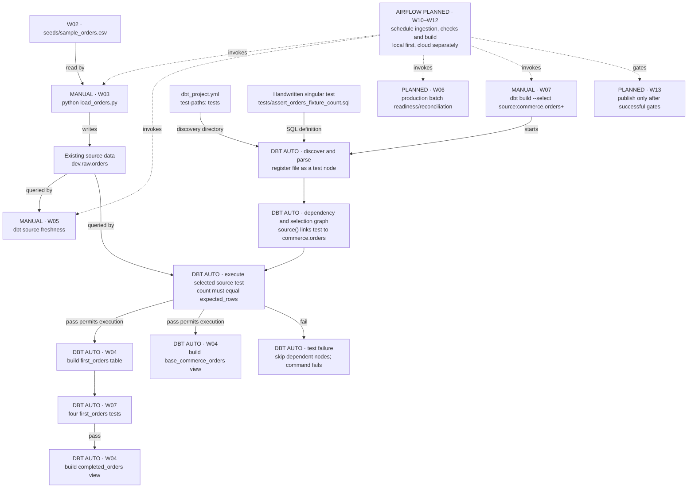
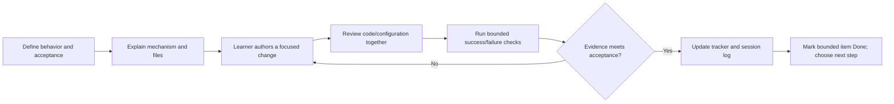

# Dataflow and developer workflow tracker

Updated: 2026-10-17 (America/Los_Angeles).

This is the current work-item status reference. The master training plan defines
the wider curriculum; this file tracks the representative orders pipeline and
its delivery workflow. No fixed session durations apply.

## Status and evidence rules

- **TBD**: planned; implementation or acceptance has not started. Design details may still need decisions.
- **In Progress**: started, but the stated acceptance is incomplete.
- **Done**: the bounded work item has the evidence stated here. It does not imply production readiness or mastery of the whole topic.
- Identify evidence as file-inspected, artifact-verified, learner-reported, or prior checkpoint. Keep local and cloud acceptance separate.
- After every training step, the agent updates the affected row, current position,
  evidence, and exact next action. Record failure and recovery without erasing the
  earlier evidence. A command supplied is not a command confirmed executed.
- Diagram nodes use work-item IDs; the table is authoritative for status.
- Update this file at every checkpoint before responding, even if the status remains unchanged. The checkpoint response must link this tracker and briefly state the current status and next action; do not wait for an owner reminder or handoff.

## Thread continuity review

- Thread label: dbt v2 Git review — resumed 2026-10-17 21:40 Pacific.
- Initialized at **0**; counted checkpoints: **9** (PR #5 integration verified).
- Last scheduled review: **5**, recorded at checkpoint 6 after the brief status clarification. Next scheduled review: **10**.
- Assessment: review due at 5 recorded now; bounded PR/integration work remains. Continue this thread. Qualitative assessment only.
- Previous thread review preserved: failure/recovery checkpoint 16 recommended optional handoff after local migration acceptance; scheduled review 15, next would have been 20.

## Where we are now

**Current: dbt v2 migration — Done (bounded WSL acceptance and PR integration).
W08 broader engineering work remains In Progress.**

On owner request, migrated to pip package dbt==2.0.8. Owner had already replaced
the active venv but requirements still named Core v1. Direct pins now include
Python duckdb==1.5.6 and pytz==2026.5 for the loader; v2's adapter is built in.
Snapshot regenerated from the actual environment: seven packages including pip.
No old Core/adapter packages remain in the inspected environment.

PR #5 squash integration verified at origin/main 2fcc0fa. Agent compared HEAD
10eb922 with origin/main: identical tracked trees, so reviewed code is unchanged.
Parent PR #4 integrated at 1d8f98b. Local main still a1b0fa8.

Four local checkpoint-note files remain modified. Next: learner creates
 docs/dbt-v2-integration-checkpoint from origin/main, carrying these notes,
then stages/reviews/commits them as one documentation checkpoint. No runtime
rerun needed. No hosted checks reported; Windows/macOS/cloud gates remain pending.
Migration publication is complete; documentation publication and local main
synchronization remain separate follow-up work. No agent Git mutation.

### dbt v2 verification, 2026-10-17

- Active WSL Python 3.14.4, dbt 2.0.8, Python DuckDB 1.5.6, pytz 2026.5.
- Recreated venv /tmp/staff_de_v2_repro_p8cq1ajh exactly matches seven snapshot pins.
- scripts/validate_dbt_runtime.py passed in both environments using fresh copies
  of sanitized project inputs and fresh dev.duckdb databases. Developer DB untouched.
- Loader, connection, freshness and preview exit 0; baseline and recovery each
  have 3 successful models + 5 passing tests; injected count=4 yields 1 failed
  test + 7 skips and exit 1. Separate artifacts preserve both cases.
- Active evidence: /tmp/staff_de_dbt_v2_ey44wfyh; recreated evidence:
  /tmp/staff_de_dbt_v2_clgtjowx. Each retains summary.json, command logs and
  baseline/failure/recovery run_results.json. /tmp retention is not guaranteed.
- Initial loader failure exposed missing pytz for timezone-aware fetch results;
  explicit dependency fixed it. dbt local leases required approved sandbox
  escalation; no account login, remote provider or cloud operation performed.
- Bash helper returns build for bu and --select/--selector for --sel; shell syntax,
  Python syntax, local Markdown links and Git whitespace checks passed.
- Native Windows/macOS, actual hosted CI, production batch reconciliation,
  publication isolation and Airflow/cloud remain pending.

## Latest failure/recovery evidence

- Core 1.12.0 log at 2026-10-17 10:04:26 Pacific: fixture-count test FAIL 1;
  PASS=0, ERROR=1, SKIP=7. All three downstream models and four downstream tests
  skipped. Logged SQL projected expected_rows=3 but compared count against 4;
  predicate triggered failure, while the diagnostic expected value was misleading.
- Recovery at 10:05:38 Pacific: PASS=8, ERROR=0, SKIP=0. JSON generated
  2026-10-17T17:05:38.559028Z confirms 3 successful models and 5 passing tests.
- Current SQL defines expected_rows=3 and compares count to that alias, eliminating
  duplicated expectations. Successful DuckDB execution verifies this local syntax;
  cross-adapter portability is not claimed.
- Both runs used target/failure, so recovery replaced the failure JSON. Persistent
  dbt.log retains failure evidence; target/recovery is absent. No rerun needed to
  establish observed blocking/recovery. Shell exit codes were not captured here.
- This is a fixture expectation test, not an actual partial-load/batch contract
  or consumer publication gate. Existing relations survive skipped builds.

## Execution ownership and test discovery

Markers identify who starts or performs each step: **MANUAL** means a learner
command; **DBT AUTO** means internal discovery/selection/scheduling after a dbt
command starts; **AIRFLOW PLANNED** means not implemented. Solid arrows show
existing execution or inputs, with labels distinguishing control from data.
Dashed arrows show future orchestration. This is an execution diagram, not a
claim that data passes through test nodes.

The singular test does not need a function call in model SQL or registration in
source YAML. `test-paths: ["tests"]` in dbt_project.yml tells dbt where to discover
it. The `assert_` prefix is descriptive, not required. The filename supplies its
test name. Parsing `source('commerce', 'orders')` records the source dependency;
the selected source/descendants bring in the associated test under the current
default test selection behavior. Discovery alone does not execute every test.

Inspected target/failure/manifest.json confirms:

- unique_id: test.training_analytics.assert_orders_fixture_count
- resource_type: test
- original_file_path: tests/assert_orders_fixture_count.sql
- depends_on.nodes: source.training_analytics.commerce.orders
- enabled: true; severity: ERROR; error_if: != 0

This manifest is generated evidence, not a file to edit. `dbt test` executes tests
without rebuilding models; `dbt build` schedules selected models and tests together.
The test is not run automatically by load_orders.py, file saving, or `dbt run`.
Freshness remains a separate manually invoked command. Airflow will invoke the
commands and enforce task dependencies; dbt will still discover and run its tests.

Models read source data directly: first_orders and base_commerce_orders use
source(); completed_orders uses ref('first_orders'). The source declaration maps
commerce.orders to dev.raw.orders; it is metadata, not a second data copy.
loaded_at is created by the loader, not dbt. The first_orders projection drops it;
base_commerce_orders retains it. Existing views can expose updated source data
even when a build is skipped, so publication isolation remains separate work.

[dbt singular tests and discovery](https://docs.getdbt.com/docs/build/data-tests?version=1.12)

## Developer workflow applied to every work item

### SQL Server / Snowflake naming example

These are illustrative target mappings, not selected or provisioned deployments.
The Azure/Databricks architecture decision in W11 remains pending.

| Layer | SQL Server example | Snowflake example |
|---|---|---|
| Connection | SQL Server instance and authenticated identity via target adapter | Snowflake account, role and compute warehouse via target adapter |
| Existing raw relation | TrainingDev.raw.orders | TRAINING_DEV.RAW.ORDERS |
| Logical dbt source | commerce.orders | commerce.orders |
| Model resource | first_orders | first_orders |
| Illustrative model output | TrainingDev.analytics.first_orders | TRAINING_DEV.ANALYTICS.FIRST_ORDERS |

The output schema must be configured; source schema raw does not set the model
output schema. `source('commerce', 'orders')` resolves the source YAML mapping to
the physical relation. `--select first_orders` selects the project model;
`--inline "select * from ..."` queries a physical relation. dbt executes SQL through
the selected adapter/connection; it does not transfer data from SQL Server to
Snowflake just because a source is declared. Such movement requires ingestion
before the Snowflake source can be queried. Credentials, permissions, SQL dialect,
adapter compatibility and deployment configuration require platform-specific work.

References: [dbt source()](https://docs.getdbt.com/reference/dbt-jinja-functions/source),
[Snowflake naming](https://docs.snowflake.com/en/en/sql-reference/name-resolution),
[SQL Server three-part names](https://learn.microsoft.com/en-us/sql/t-sql/functions/object-name-transact-sql).

The table names the maintained files or intended deliverables for each item.
`target/` and `logs/` contain generated execution evidence, not hand-authored
configuration. Git/PR/CI promotion is a planned addition in W08–W09, not an active
enforcement mechanism. Preserve learner-led exercises rather than implementing
them silently for the learner.

## Work items and acceptance

| ID / work item | Status | Developer workflow: author → execute/review → accept | Evidence and remaining work |
|---|---|---|---|
| W01 — Canonical WSL workspace and dbt runtime | Done | Preserve notes in WSL → activate Linux `.venv`, inspect selected executable, run connection check → confirm working local runtime | Prior checkpoint: all 18 source files matched before local edits; VS Code WSL confirmed. This thread: learner ran Core 1.12.0 / DuckDB 1.11.0 after PATH correction. Permanent shell startup ordering remains unverified; PowerShell variable and Azure setup are separate pending work. |
| W02 — Fictional seed fixture | Done | Author `seeds/sample_orders.csv` → load/preview fixture → verify representative rows | Prior checkpoint: three-row seed preview and completed orders 1 and 3 reported. Fixture is now reused by Python ingestion. |
| W03 — Minimal local ingestion prototype | Done | Author `load_orders.py` → create/replace `raw.orders`, add load timestamp → inspect loaded row count/timestamp | File inspected; earlier learner reported three rows and timestamp. Recovery reload reported this thread. Scope is demonstration only; professional loader is W08. |
| W04 — Logical source and SQL model chain | Done | Maintain `models/sources.yml` and model SQL → resolve `source()`/`ref()`, inspect compiled SQL and preview → verify dependency chain | Prior checkpoint: compiled `FROM dev.raw.orders`, completed orders 1 and 3 preview. Files inspected again. Does not establish a full source-backed build/test acceptance; see W07. |
| W05 — Freshness and source inspection | In Progress | Add table-level freshness config in `sources.yml` → run stale/reload/check and raw preview → explain thresholds, timestamps, selectors, exit status and `sources.json` | Config inspected: warn >5 min, error >10 min. Core stale failure supplied; recovery PASS learner-reported; latest artifact warn verified. Learner aggregate output confirms 3 rows / 3 distinct IDs and latest_load 2026-10-15T21:26:19.750278-07:00. Learner raw preview matches all fixture rows and shows identical loaded_at values. Checkpoint 11 learner correctly explains timestamp freshness versus exact count (2<>3). Minimum-count consequences explained by tutor, not independently demonstrated; exit code not supplied. |
| W06 — Input readiness and batch completeness | In Progress | Define expected batch/input contract and reconciliation → implement checks → demonstrate missing/partial loads block downstream work | Fixture-only exact count=3 test now named assert_orders_fixture_count.sql; PASS/zero failures artifact verified at checkpoint 9 (dbt 2.0.8). Failure predicate count<>4 and restored count<>expected_rows=3 recovery verified from log/artifact at checkpoint 10. Core 1.12.0 successful selected build verified at prior checkpoint 22; negative-case evidence pending. Batch identity, independent expected counts, missing/partial failure and downstream gating remain pending. Do not generalize fixture count to production. |
| W07 — Source-backed build/test and failure recovery | In Progress | Maintain `models/orders.yml` with SQL → build/test, inject bounded invalid input, inspect failure and restore → verify current full source-backed build and recovery | Prior checkpoint verifies four first_orders tests and deliberate duplicate failure before the current source-backed acceptance. Checkpoint 11: learner output and artifact verify selected source-backed build: 3 models success / 5 tests pass, dbt 2.0.8. Checkpoint 22 additionally verifies Core 1.12.0 selected build: 3 models / 5 tests pass using recreated environment/template. Checkpoint 8 in failure/recovery thread verifies target/failure/run_results.json is a successful baseline, Core 1.12.0, 3 models and 5 tests; SQL still expects 3. Source-count failure (1 test fail, 7 skips) and recovery (3 models, 5 tests pass) verified at checkpoint 10; learner interpretation and Git acceptance next. |
| W08 — Maintainable Python loader and repository foundation | In Progress | Refactor prototype into reusable logic/configuration; establish Git and reproducible dependencies → validate inputs, errors/logging, safe writes and meaningful tests → demonstrate repeatability and recovery | Historical Git baseline and Core v1 reproduction retained. Failure/recovery thread checkpoint 16 migrates to dbt 2.0.8, verifies seven-package clean reproduction and fresh-database success/failure/recovery. Review/commit/integration and loader refactor remain pending; define batch/write semantics before expanding loader. |
| W09 — dbt professional delivery and CI/CD | TBD | Author isolated targets and CI configuration → exercise reviewed SQL/YAML change, failing checks, correction and promotion → verify artifact retention and cleanup | Local CI simulation, hosted CI, and deployed execution need distinct evidence. Teach manifest/state/deferral after basic build isolation. |
| W10 — Local Airflow pipeline | TBD | Author DAG/config using reusable ingestion → ingest, readiness/freshness/completeness, dbt build/test, publication gating → prove success and blocked downstream tasks/recovery | Cover data intervals, retries, idempotency, backfills, concurrency, secrets and logs. No scheduler or DAG deployment verified. |
| W11 — Cloud design and billing readiness | TBD | Choose compatible Azure/Databricks target and cloud Airflow hosting; estimate costs → verify billing, identity and budget alerts → approve bounded lab design and teardown | $200/month ceiling, target below $150. Billing upgrade and budget configuration unverified. Alerts are not a hard cap. Verify current official guidance before provisioning. |
| W12 — Actual cloud implementation | TBD | Adapt storage/identity/runtime and deploy approved revision → run cloud-hosted Airflow plus analytical workload → verify success, failure/recovery, cost and teardown | Required outcome. Local simulation or local Airflow calling cloud storage does not count as cloud-hosted orchestration. SQL/Delta first, gradual PySpark exposure. |
| W13 — Consumer / BI publication | TBD | Define consumer contract and semantic/report output → publish only after upstream gates → verify output and failure behavior | Consumer implementation and hosting still undecided. Existing completed_orders view is a teaching output, not a deployed BI product. |
| W14 — Operational and portfolio acceptance | TBD | Maintain runbook, architecture decisions and scenario evidence → rehearse failures/backfill/schema change and recovery → review reproducibility, ownership and local/cloud proof | Include missing input, partial/stale batch, duplicates, late arrival, schema drift and task failure. Deeper Python follows gradual exposure; broader curriculum remains in the master plan. |

## Step history

| Date (Pacific) | Step | Evidence / status effect |
|---|---|---|
| 2026-10-15 | Reconciled current handoff and files | Resumed source freshness rather than repeating setup. |
| 2026-10-15 | Diagnosed dbt executable selection | Learner selected user-installed 2.0.8 despite active venv; reactivation restored Core 1.12.0. |
| 2026-10-15 | Exercised stale check and reload | Learner supplied stale failure and reported recovery PASS; W05 still requires interpretation/preview acceptance. |
| 2026-10-15 | Explained physical vs logical names | `--select dev.raw.orders` selected nothing; source preview command supplied, output pending. |
| 2026-10-15 | Created living dataflow/workflow tracker | Inspected latest freshness artifact: warn. Added mandatory per-step tracking to project instructions. |
| 2026-10-15 | Confirmed visible updates at every checkpoint | Agent must update before each checkpoint response and include a tracker link with status/next action. W05 remains In Progress; source preview and interpretation remain next. |
| 2026-10-15 | Assigned W05 source inspection checkpoint | Supplied dbt show source preview and a single completeness reasoning check. Awaiting learner evidence; no command executed by agent and no status promotion. |
| 2026-10-15 | Clarified source selector naming | Rechecked sources.yml: logical source commerce, table orders; database dev and schema raw are physical mapping properties, not selector segments. Use source:commerce.orders. W05 remains In Progress; preview and comprehension pending. |
| 2026-10-15 | Clarified dbt show selection versus SQL | dbt show --select dev.raw.orders does not interpret the physical address as SQL. Use --inline "select * from dev.raw.orders" or the source() mapping to preview raw rows; --select first_orders previews the dbt model. W05 remains In Progress; learner preview pending. |
| 2026-10-15 | Refined selector mental model | Clarified that dbt's resource selector, not a model or the database connection, fails to match dev.raw.orders. Physical table addresses belong in SQL. W05 remains In Progress; preview and completeness check pending. |
| 2026-10-15 | Mapped naming to SQL Server and Snowflake | Added illustrative connection/source/model/output mapping and ingestion boundary. No platform selected or provisioned; W05 remains In Progress and W11 remains TBD. |
| 2026-10-16 | Resumed with raw preview and aggregate diagnostic | Rechecked fixture: three orders, IDs 1–3. Assigned read-only preview plus row count/distinct ID/latest load query. Output pending; W05 remains In Progress. No completeness gate implemented. |

| 2026-10-16 | Strengthened proactive thread continuity | Root and training AGENTS.md now require qualitative length checks at checkpoints, saved handoff before transition advice, and visible resume summary/prompt. W05 remains In Progress; preview/aggregate outputs pending. |

| 2026-10-16 | Cadence baseline checkpoint 1: continuity review | Added explicit review every five checkpoints; early qualitative handoff recommended before the next phase. Saved handoff; W05 preview/diagnostic results still pending. |

| 2026-10-16 | New thread checkpoint 1: resumed W05 | Read canonical instructions, handoff and numbered logs; re-inspected source YAML, loader and three-row fixture. Initialized counter at 0, incremented to 1 for this assignment; review due at 5. Preview and aggregate commands reissued for learner execution, results and completeness reasoning still pending. No data reload or dbt execution by agent; W05 remains In Progress. |

| 2026-10-16 | New thread checkpoint 2: aggregate evidence | Learner supplied actual_rows=3, distinct_orders=3 and latest_load=2026-10-15T21:26:19.750278-07:00. Matches fixture count without establishing exact IDs or values. Raw preview and completeness reasoning pending; no current freshness command result inferred. W05 In Progress; next review at 5. |

| 2026-10-16 | New thread checkpoint 3: raw preview evidence | Learner preview matches fixture IDs 1–3, statuses and amounts; all rows show loaded_at 2026-10-15T21:26:19.750278-07:00. Raw preview acceptance recorded; completeness reasoning still pending. W05 In Progress; next review at 5. |

| 2026-10-16 | New thread checkpoint 4: count-based completeness proposal | Learner proposed min_count. Explained that newest loaded_at can pass freshness with one recent row; a lower bound detects shortages but can admit extras. For an exact 100-order batch contract, reconcile batch-scoped actual/distinct counts with an independently supplied expectation. Understanding of exact versus minimum counts and expected-count provenance remains pending; no gate implemented. W05 In Progress; review due at 5. |

| 2026-10-16 | New thread checkpoint 5: source tests and continuity review | Explained YAML config versus executed SQL on source data, selected data tests in dbt build, separate Core freshness command, and need to author a count test. No test added or executed. W05 In Progress; count contract reasoning pending. Scheduled qualitative review: bounded history and one active branch, continue; next review 10. |

| 2026-10-16 | New thread checkpoint 6: first completeness test assigned | Owner requested next step. Verified test-paths points to tests; assigned learner-authored singular SQL test assert_orders_fixture_count and targeted dbt test. Exact count=3 is bounded to fixture; no code authored or dbt run by agent. W06 In Progress; W05 reasoning still pending. |

| 2026-10-16 | New thread checkpoint 7: diagnosed Jinja syntax error | Learner supplied dbt1502 error. Inspected tests/asser_orders_fixture_count.sql: stray P before source() in Jinja; aggregate logic otherwise matches exercise. Supplied exact line correction and selector matching actual filename. No file edit or dbt execution by agent; rerun pending. W06 In Progress. |

| 2026-10-16 | New thread checkpoint 8: saved correction verified | Re-inspected test: stray P removed, source() expression valid. Learner repeated same error; cannot establish whether output predates save or came from another runtime. Supplied existing-venv activation, executable/version check and targeted rerun. No agent test execution. W06 In Progress. |

| 2026-10-16 | New thread checkpoint 9: count-test PASS verified | Inspected renamed assert_orders_fixture_count.sql and run_results.json: PASS, zero failures, dbt 2.0.8. Assigned temporary expectation 4 then restoration 3 to prove failure/recovery without source mutation. This is not partial-ingestion/gating acceptance. W06 In Progress; runtime consistency remains open; next continuity review 10. |

| 2026-10-16 | New thread checkpoint 10: build assignment and continuity review | File still expects 3; latest PASS artifact unchanged and no new count-test failure/recovery in inspected log. Assigned source-descendant dbt build; no execution claimed. W07 In Progress, W06 failure/recovery and W05 reasoning pending. Qualitative review: focused history, explicit open items; continue, next review 15. |

| 2026-10-16 | New thread checkpoint 11: selected build success verified | Learner output and run_results.json confirm 3 successful models / 5 passing tests, dbt 2.0.8. Inspected base_commerce_orders: direct source projection retaining loaded_at, separate branch from first_orders. Diagram updated. Assigned temporary count=4 build failure/skip, then restore=3 recovery; pending. W07 In Progress. |

| 2026-10-16 | New thread checkpoint 12: mandatory Git lifecycle | Owner requires production-style lifecycle and meaningful Git checkpoints. Updated instructions/master plan/capstone, prepared root .gitignore, rechecked no repo. Assigned learner git init and status before staging review; no Git mutation by agent. W08 In Progress, existing failure/recovery evidence pending. |

| 2026-10-16 | New thread checkpoint 13: branch-to-release procedure | Owner requires branching and all proper lifecycle steps. Plan now specifies baseline bootstrap, clean-main feature branch, acceptance/diff/validation/staging/commit, hosted PR/CI/review, conflict handling, integration/cleanup and release/recovery. Local simulation versus hosted enforcement and solo-review limits explicit. No Git operations executed; learner init/status remains next. |

| 2026-10-16 | New thread checkpoint 14: repository initialization verified | git status/branch confirm main with untracked files; HEAD absent. Added .vscode/ and .user.yml exclusions. Assigned explicit staging plus staged stat/check/diff review; no agent staging or commit. W08 In Progress; first feature branch follows reviewed baseline. |

| 2026-10-16 | New thread checkpoint 15: staged baseline review | 41 staged files inspected for scope; bounded credential scan no matches. Whitespace check found SQL/YAML whitespace and Markdown hard breaks; working-tree cleanup preserves behavior/formatting. Learner restage/check/commit next. Scheduled qualitative review: finish baseline here, reassess before runtime phase; next scheduled review 20. |

Checkpoint 15 follow-up: Git warned of LF-to-CRLF conversion. Prepared repository .gitattributes (* text=auto eol=lf); stage it before renormalizing baseline. No global Git config change.

| 2026-10-16 | New thread checkpoint 16: baseline commit and command format | Verified clean main and baseline commit 8590240 before docs edits. Owner requires one shell command per separate code block; persisted in root/linked AGENTS.md. Assigned docs/command-format branch and diff review for requested docs changes. No agent branch/commit operation. |

| 2026-10-16 | New thread checkpoint 17: documentation branch verified | Confirmed docs/command-format, six modified docs files, instruction diff matches request; whitespace check passed. Assigned explicit staging, cached review/check and focused docs commit. No agent staging/commit; local integration next after commit verification. |

| 2026-10-16 | New thread checkpoint 18: docs commit verified | Verified dfd276c, clean docs/command-format before checkpoint updates; main at 8590240; branch diff whitespace check passed. Assigned checkpoint-record commit then explicit local no-ff merge and safe merged-branch deletion. No integration execution confirmed. |

| 2026-10-16 | New thread checkpoint 19: merge attempt blocked | Agent attempted user-supplied merge; sandbox denied Git metadata write and escalation was declined. No agent merge completed. Recorded retrospectively at checkpoint 20 to preserve continuity. |
| 2026-10-16 | New thread checkpoint 20: merge verified, push destination needed | Verified main 4150ae0, clean before notes, docs branch absent, no remotes. Owner requested push; remote URL required. No push attempted. Scheduled qualitative review: resolve publication checkpoint then reassess handoff before runtime phase; next scheduled review 25. |

| 2026-10-16 | New thread checkpoint 21: GitHub account identified | Owner supplied github.com/AmolAdhav. No remote configured; gh executable exists at /usr/bin/gh, authentication not checked. Repository name/existence and visibility not specified; propose private staff_de_training or ask for existing repo URL. No creation/push attempted; four checkpoint docs remain uncommitted. |

| 2026-10-16 | New thread checkpoint 22: creation permission declined | Owner accepted new private AmolAdhav/staff_de_training. gh login verified outside network sandbox. Combined create/origin/push command was rejected before execution by user permission decision; no creation/push confirmed. Provided learner command, no alternate execution route attempted. |

| 2026-10-16 | New thread checkpoint 23: publication checkpoint | Owner reported push and supplied private GitHub repo metadata with default main. Inspected origin URL and equal local main/cached origin/main at 4150ae0. Agent live check declined, no remote SHA fetched. Four checkpoint docs uncommitted. Early qualitative handoff recommended before runtime phase; docs publication branch next. |

| 2026-10-16 | Git/runtime thread checkpoint 1: resume verified | Owner confirmed new thread; initialized counter at zero, incremented for this exercise. Inspected main/cached origin/main at 4150ae0 and exactly four modified checkpoint docs; docs/publish-checkpoint does not yet exist. Assigned learner branch creation and diff review; no Git mutation or live remote query. Runtime work follows documentation integration on a separate branch. |

| 2026-10-16 | Git/runtime thread checkpoint 2: documentation branch verified | Learner output and local inspection confirm docs/publish-checkpoint with exactly four modified checkpoint docs. Reviewed diff and whitespace check passed. Updated checkpoint before assigning explicit staging, cached review/check and commit; no agent Git mutation. Integration and runtime branch remain pending. |

| 2026-10-16 | Git/runtime thread checkpoint 3: documentation commit verified | Inspected c0ed731 on docs/publish-checkpoint; clean worktree before this record, main/cached origin/main at 4150ae0. Four-file branch diff passes whitespace check. Assigned review-record commit, learner branch push and hosted PR; none executed by agent. Hosted CI and independent peer approval remain absent; review PR before integration. |

| 2026-10-16 | Git/runtime thread checkpoint 4: PR integrated | Owner reported merge/deletion. Cached origin/main contains PR #1 merge 191dd10; local docs branch absent. With approved escalation, agent fast-forwarded clean main from 4150ae0 to 191dd10 before checkpoint edits. Assigned separate runtime branch and venv executable/version diagnostics; no runtime changes or installs. |

| 2026-10-16 | Git/runtime thread checkpoint 5: credential helper diagnosis | Owner pull emitted missing credential-manager. Inspected Linux git/gh and helper manager inherited from Windows .gitconfig through WSL global include. Main/cached origin/main remain 191dd10; pull success not inferred. Assigned repository-local GitHub helper reset plus gh helper and pull --ff-only; no credentials read or config changed by agent. Scheduled qualitative review: continue, next review 10. |

| 2026-10-16 | Git/runtime thread checkpoint 6: runtime mismatch narrowed | Owner reports dbt 2.0.8. Explicit project venv Python metadata verifies dbt-core 1.12.0 and dbt-duckdb 1.11.0. Runtime branch exists; four checkpoint docs modified. Assigned shell resolution and explicit venv CLI comparison; no installs or dbt data operations. Git authentication recovery remains unconfirmed. |

| 2026-10-16 | Git/runtime thread checkpoint 7: explicit venv CLI verified | Owner output confirms .venv/bin/dbt runs Core 1.12.0 / DuckDB 1.11.0. Bare dbt previously reported 2.0.8; requested type -a dbt to distinguish alias/function/PATH selection. No upgrade or package change; update notice is not a runtime acceptance requirement. |

| 2026-10-16 | Git/runtime thread checkpoint 8: shell lookup evidence | Learner type -a shows venv dbt first, then four user-bin occurrences; no alias/function. Assigned hash -r and fresh bare dbt --version. Prior 2.0.8 cause not proven; do not claim cache or startup-file diagnosis. No package/PATH edits. |

| 2026-10-16 | Git/runtime thread checkpoint 9: dependency declaration assigned | Owner acknowledged runtime success, no fresh version output. Verified venv Python 3.14.4, Core 1.12.0, adapter 1.11.0, DuckDB 1.5.6 and direct loader import. Assigned learner root requirements.txt and pip check; no dependency file authored or install by agent. Full lock, clean reproduction, profile template and runbook pending. |

| 2026-10-16 | Git/runtime thread checkpoint 10: installed dependencies pass | Learner pip check reports no broken requirements. Root requirements.txt absent and filename search found no requirements files outside excluded environment/artifact paths. Assigned save of three-pin declaration; no file authored by agent. Scheduled qualitative review: continue with bounded gap, next review 15. |

| 2026-10-16 | Git/runtime thread checkpoint 11: declaration verified | Root requirements.txt inspected: all three pins match intended environment. Existing pip check success remains learner-reported. Assigned explicit venv pip freeze --all to requirements_snapshot.txt and review; snapshot not yet generated by agent. Snapshot is not a solver lock or cross-platform acceptance. |

| 2026-10-16 | Git/runtime thread checkpoint 12: snapshot reviewed | requirements_snapshot.txt inspected: 60 exact pins, intended three dependencies and pip included, no URL/local-path entries. Venv Python 3.14.4, no system site packages. /tmp/staff_de_training_repro absent. Assigned learner clean venv/install/pip check/dbt version; no environment created or packages installed by agent. |

| 2026-10-16 | Git/runtime thread checkpoint 13: package reproduction verified | Learner recreated pip check PASS and intended dbt versions. Agent compared all 60 normalized package names/versions with snapshot: exact match, Python 3.14.4. Inspected non-secret DuckDB profile fields; assigned recreated-runtime dbt debug with explicit project/profile directories. No dbt/database command run by agent. |

| 2026-10-16 | Git/runtime thread checkpoint 14: portable profile assigned | Owner acknowledged debug success without output; learner-reported connection acceptance. Verified existing profiles.yml ignored and no example template found. Assigned learner profiles.example.yml using required DBT_DUCKDB_PATH; existing profile untouched. Template validation, runbook and intended-runtime build remain pending. |

| 2026-10-16 | Git/runtime thread checkpoint 15: command references | Owner requested two commented text cheat sheets with numbered sections/steps. Created docs/bash_commands.txt and docs/powershell_commands.txt, matching workflow sections and WSL shell boundaries; persisted maintenance rule in linked AGENTS.md. Template still absent; B06/P06 is next. Bash syntax checked; native PowerShell unavailable. Scheduled qualitative review: continue with bounded profile exercise; next review 20. |

| 2026-10-16 | Git/runtime thread checkpoint 16: profile exercise resumed | Rechecked runtime branch and absent profiles.example.yml. Directed learner to B06/P06 template authoring and steps 01-05; expected recreated-runtime debug success. No template created or validation executed by agent. |

| 2026-10-16 | Git/runtime thread checkpoint 17: parallel reference and dev work | Owner clarified native Windows-only PowerShell commands and requested multitasking while continuing dev. Delegated PowerShell reference rewrite; persisted native-tool boundary. Template still absent; added executable authoring command B06 step 00, then existing validation steps 01-05. Learner execution pending; no template/database mutation by agent. |

Checkpoint 17 completion: native Windows PowerShell reference reviewed; no WSL
command wrappers or Linux executables. Separate LOCALAPPDATA environment, profile,
snapshot and database; UNC accesses canonical files only. Native pipeline loader
adaptation remains explicitly pending. Numbering/static checks pass; no native
PowerShell interpreter available, so execution is unverified.

| 2026-10-16 | Git/runtime thread checkpoint 18: next branch action | Verified fix/runtime-reproducibility; template still absent. Existing dbt log contains successful connection check, but does not establish template validation. Reissued B06 step 00 creation command directly; steps 01-05 follow, then runbook/build review and Git checkpoint. No agent implementation/database operation. |

| 2026-10-16 | Git/runtime thread checkpoint 19: profile template verified | Inspected profiles.example.yml: intended profile, dev output, duckdb, required env path, schema main, threads 1. Existing debug log covers original profile only. Assigned B06 steps 01-05; skip step 00. Updated command-reference template status. |

| 2026-10-16 | Git/runtime thread checkpoint 20: template connection verified | Inspected temporary profile and debug log: /tmp/staff_de_training_profiles/profiles.yml, All checks passed. Assigned B06 step 06 build using recreated runtime/template against existing raw source. No reload, freshness or build run by agent. Scheduled qualitative review: finish bounded runtime acceptance here; reassess before next feature, review due 25. |

| 2026-10-16 | Git/runtime thread checkpoint 21: debug evidence supplied | Owner output confirms recreated Python 3.14.4, Core 1.12.0, adapter 1.11.0, temporary profile and All checks passed. Command was debug, not build; no model/test acceptance inferred. Reissued B06 step 06 build command explicitly. |

| 2026-10-16 | Git/runtime thread checkpoint 22: Core build verified | Inspected run_results.json: Core 1.12.0 build with temporary profile, 3 successful models and 5 tests pass/zero failures. Replaced scaffold README with verified runbook and explicit limits; added B11/P11 exact staging/review/commit recipe. No agent Git mutation. Negative-case recovery, native Windows and hosted CI still pending. |

| 2026-10-16 | Git/runtime thread checkpoint 23: commit not yet created | Inspected fix/runtime-reproducibility: HEAD still 191dd10, index empty, seven tracked docs changes and five untracked runtime/reference files. B11 staging/review/commit remains next; do not push/open an empty feature PR. No agent Git mutation. |

Checkpoint 23 additional evidence: owner supplied matching Core 1.12.0 build
output, PASS=8/WARN=0/ERROR=0/SKIP=0. Three selected models and five tests passed;
Found 5 models/9 tests describes total discovered resources, not selected results.
Build acceptance complete for this selection; B11 steps 03-08 remain next.

| 2026-10-16 | Git/runtime thread checkpoint 24: generic command flows | Verified runtime commit 503461e and clean worktree before docs revision. Owner requests reusable flows with figlet banners and environment-variable setup. Rebuilt both text references around VARIABLES, NEW CODE, CHANGED CODE, PUBLISH, runtime/profile/validation and AZ ACCOUNT; native Windows only in PowerShell. Updated README/instructions. No agent Git, package, database or Azure actions; native execution unverified. |

| 2026-10-16 | Git/runtime thread checkpoint 25: partial documentation commit | Verified 6a464f2 contains README only; eight tracked documentation files remain modified, index empty. Runtime commit 503461e retained; cached upstream matches local feature branch. Added interactive staging guidance, assigned B11 review/commit for remaining docs. Scheduled qualitative review: finish bounded Git checkpoint, reassess before new feature; next review 30. |

| 2026-10-16 | Git/runtime thread checkpoint 26: staging still pending | Rechecked HEAD 6a464f2, empty index and same eight tracked docs changes. Simplified generic CHANGED CODE step 04 to git add -u for wholly reviewed tracked scope, with partial/untracked guidance. Supplied direct stage/review/check/commit commands; no agent Git mutation or publication. |

| 2026-10-16 | Checkpoints 27–29 reconciliation after merge | Conversation records docs commit 99d7858 verification, owner PR #2 OPEN, no hosted checks and final integration assignment. Merged tracker retained only checkpoint 26; restored count from conversation without inventing execution. |

| 2026-10-16 | Git/runtime thread checkpoint 30: Markdown runbooks | Main/cached origin/main c31160a verifies PR #2 squash integration; clean before edits. Replaced command .txt files with concise Markdown lifecycle runbooks, updated README/instructions and recorded native/deployment limits. Documentation checks pass; no runtime/cloud commands or Git mutations by agent. Optional new-thread handoff recommended at completed phase boundary; pending docs branch/commit recorded. |

| 2026-10-16 | Failure/recovery thread checkpoint 1 | Verified clean main/cached origin/main a1b0fa8: Markdown migration already committed. Static runbook review passed; no duplicate commit or remote operation. New thread counter initialized. Assigned learner feature branch and expectation 4 failure, then expectation 3 recovery with separate artifacts; no SQL/database changes or exercise runs by agent. |

| 2026-10-16 | Failure/recovery thread checkpoint 2 | ANSWER NOW: installed dbt Click completion returns build for bu and --select/--selector for --sel; Bash source generation succeeds. Added session-only activation to Bash runbook. No shell startup edits or learner activation confirmed. Failure/recovery remains pending; next review 5. |

| 2026-10-16 | Failure/recovery thread checkpoint 3 | Learner reports completion not working. Agent isolated Bash activation registers dbt and returns COMPREPLY=build for bu; this does not verify learner interactive shell. Requested shell/version, dbt resolution and completion registration output. No startup edits; pipeline failure/recovery still pending. |

| 2026-10-16 | Failure/recovery thread checkpoint 4 | Learner Bash 5.3.9 output shows ~/.local/bin/dbt before project venv and complete -F _complete_it dbt. Intended Click registration absent; origin of conflicting function not established. Assigned session PATH correction, hash reset and Click re-registration, followed by executable/function verification. Locally verified feature/source-failure-recovery exists; five docs modified, SQL unchanged. Recovery and interactive completion acceptance pending. |

| 2026-10-16 | Failure/recovery thread checkpoint 5 | Inspected ~/.local/bin/dbt: standalone ELF executable, --version reports 2.0.8. Project venv reports Core 1.12.0/duckdb 1.11.0. User-level binary matches documented standalone installer destination, but installer origin/actor unknown. No removal or startup edits. Review 5: continue bounded diagnosis; next review 10. Completion correction and pipeline exercise remain unconfirmed. |

| 2026-10-16 | Failure/recovery thread checkpoint 6 | Owner asked how to remove standalone dbt. Supplied exact ~/.local/bin/dbt removal, Bash hash reset, project venv activation, executable/version verification and Click re-registration. Commands supplied only; no agent deletion or confirmed learner removal. Project venv retained; pipeline exercise pending. |

| 2026-10-16 | Failure/recovery thread checkpoint 7 | Clarified ~/.bashrc shell completion versus dbt profiles.yml connection configuration. Added generated venv-local completion script and guarded Bash startup source recipe to runbook. No user startup-file edit or generation executed by agent; binary removal and persistence acceptance remain unconfirmed. Pipeline exercise pending. |

| 2026-10-16 | Failure/recovery thread checkpoint 8 | Learner reports build success. Inspected target/failure/run_results.json generated 2026-10-17T03:52:00.431151Z: Core 1.12.0, 3 models successful and 5 tests pass; source test failures=0. SQL still expects 3, so this is baseline success, not negative-case acceptance. Explained target-path only routes artifacts. Assigned both literals 3→4, diff review, same build and immediate exit-code capture. No agent SQL/build operation. |

| 2026-10-17 | Failure/recovery thread checkpoint 9 | Learner reports success. Latest failure-path artifact at 2026-10-17T17:01:44.997589Z still has 3 successful models/5 passing tests; log summary PASS=8 ERROR=0 SKIP=0. SQL still expects 3 and recovery artifact absent. Negative case not evidenced. Supplied exact expectation-4 SQL to save, then selected build/exit capture; no agent SQL edit or database operation. |

| 2026-10-17 | Failure/recovery thread checkpoint 10 | Inspected log: 10:04:26 FAIL 1 source test, ERROR=1/SKIP=7; logged projection retained expected_rows=3 while HAVING used 4. Recovery 10:05:38 PASS=8, confirmed by current JSON. Learner SQL now uses expected_rows alias with value 3, avoiding duplicate literals. Failure JSON overwritten by recovery but log retains proof; no repeat build required. Assigned freshness/completeness reasoning then scoped Git review. Review 10: continue bounded phase, next review 15. |

| 2026-10-17 | Failure/recovery thread checkpoint 11 | Learner correctly explains freshness checks timestamps while exact count rejects 2 versus 3. Explained minimum >=3 admits extra rows and count alone cannot prove membership/uniqueness. Six modified files verified on feature/source-failure-recovery; only SQL change is HAVING alias reuse, expectation remains 3. Diff whitespace check passes. Assigned learner whole-diff review before explicit staging/commit; no Git mutation by agent. |

| 2026-10-17 | Failure/recovery thread checkpoint 12 | Verified feature/source-failure-recovery at a1b0fa8, six modified files, empty index and no new commit. SQL restores fixture expectation 3 and uses alias in HAVING. Bash runbook snippets pass bash -n; diff whitespace passes. Assigned explicit six-file staging, cached diff/check, local commit and status. No agent staging/commit/push; hosted PR and CI acceptance remain pending. |

| 2026-10-17 | Failure/recovery thread checkpoint 13 | Verified local commit 1756d63 contains six intended files; feature/source-failure-recovery clean before this checkpoint, no upstream shown. Prepared /tmp/staff_de_training_failure_recovery_pr.md and assigned learner push, PR creation and checks. No remote operation by agent. Four new checkpoint-note edits remain uncommitted and are not part of 1756d63; consolidate at next Git boundary, do not delay publishing reviewed implementation. |

| 2026-10-17 | Failure/recovery thread checkpoint 14 | Explained current source count gate runs inside selected dbt build after loader writes raw.orders, before dependent models. source() connects test and models to same source; error-severity failure causes observed skips. Loader is not rolled back; pre-existing raw-backed base view can expose changed raw rows despite skipped rebuild. Future orchestrator must propagate command failure and gate publication; no Airflow/publication gate exists yet. PR commands remain supplied, execution not checked this turn. |

| 2026-10-17 | Failure/recovery thread checkpoint 15 | Inspected explicit test-paths in dbt_project.yml and generated manifest test node/source dependency/severity. Explained discovery versus selection versus execution; assert_ is not a required prefix. Replaced tracker diagram with MANUAL, DBT AUTO and AIRFLOW PLANNED markers and explicit singular-test file. No runtime execution. Review 15: continue to PR checkpoint, reassess before new implementation; next review 20. |

| 2026-10-17 | Failure/recovery thread checkpoint 16 | Owner explicitly requests agent v2 migration. With permission created feature/dbt-v2-migration from 1756d63. Replaced Core/adapter pins with dbt 2.0.8 plus loader duckdb/pytz, regenerated seven-package snapshot, added v2 bound, validation runner and Bash completion helper; updated runbooks/README. Active and clean reproduced envs pass fresh-load, freshness, build, source-test failure/skips, recovery and preview. SQL/profile unchanged. No agent commit/push. Early qualitative handoff useful before next phase; next scheduled review 20. |

| 2026-10-17 | dbt v2 Git review checkpoint 1 | Reviewed runtime/script/runbook diff; whitespace check passes. Prior local acceptance retained, no rerun. Owner output confirms parent PR #4 OPEN, mergedAt/mergeCommit null. Agent network approval declined. Supplied scoped stage/review/commit, parent squash merge, fetch and rebase --onto origin/main 1756d63, then migration publication commands. Commands only; no Git mutations or integration confirmed. |

| 2026-10-17 | dbt v2 Git review checkpoints 2–3 | Diagnosed stale-target rebase; learner aborted. Parent PR #4 now MERGED per owner output; origin/main 1d8f98b verified locally, tree identical to 1756d63. Migration e191883 retained and worktree clean before notes. Assigned checkpoint-note commit followed by migration-only rebase and review; execution pending. |

| 2026-10-17 | dbt v2 Git review checkpoint 4 | Rebase success verified: 6b1efc1 and 10eb922 atop origin/main 1d8f98b. Clean before notes, whitespace passes; code/runbooks unchanged from e191883. Supplied push/PR/check commands; execution pending. Checkpoint notes remain local for next Git boundary, not another pre-publication commit requirement. |

| 2026-10-17 | dbt v2 Git review checkpoints 5–6 | Clarified four local note edits do not block pushing committed history. Owner push output confirms feature branch publication; HEAD and cached upstream both 10eb922. PR creation next. Review 5 recorded at 6: continue bounded PR/integration phase; next review 10, qualitative assessment. |

| 2026-10-17 | dbt v2 Git review checkpoint 7 | Owner reports no checks on feature/dbt-v2-migration. Local acceptance retained; no hosted CI pass claimed. Assigned read-only gh pr view for number/state/base/head/mergeability/check rollup before integration. |

| 2026-10-17 | dbt v2 Git review checkpoint 8 | Owner PR #5 output confirms OPEN, main base, migration head, MERGEABLE/CLEAN, empty checks. Supplied learner squash merge, PR merge verification and fetch/history commands. Merge not yet confirmed; retain four local notes and current branch during remote merge. |

| 2026-10-17 | dbt v2 Git review checkpoint 9 | Verified origin/main 2fcc0fa integrates PR #5; tracked tree equals reviewed HEAD 10eb922. Bounded migration Done. Four checkpoint notes finalized for learner docs branch/commit from origin/main. Local main synchronization and docs publication pending; no runtime rerun. |
